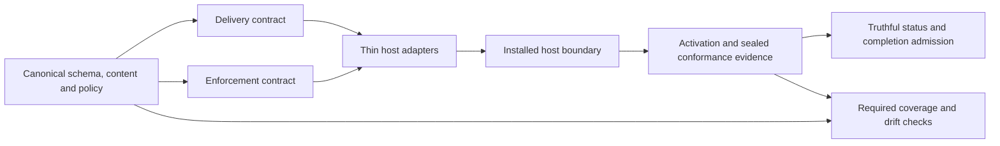

# Impl Plan: Reduce duplicated maintenance and agent drift

**Status:** planned  
**Planned on:** 2026-10-30  
**Current amendment:** 2026-11-23, OpenCode 2.4.1 retarget and requalification.

Canonical content and policy feed existing host codecs and generated delivery. Installed observations feed trusted conformance and activation readers. Proof from one host cannot authorize another.

The [prior execution plan](execution-plan.md) preserves its original targets and
results. Execution Planning owns the refreshed commands, timing and proof records
after approach approval.
The plan at commit `eaca26a3a` is subordinate historical evidence only.

## Current-main architecture review qualification

Main’s `da2778353` retired the cross-model requirement and the
author-model capture hook. For current qualification, this supersedes every
earlier `Q-author-origin`, `architecture-author-origin`, and
`crossModelReview` requirement in this plan. Earlier observations retain
their original scope.

Prove through the installed Stop hook that an authenticated current reduced
review satisfies the opt-in architecture gate. Prove that stale and
unapproved receipts are refused. Keep the separate native Stop, configured
settings, continuation-limit, and lifecycle requirements. Keep the isolated
wiring grader’s own model-pair check. The headless runner retains the
three named receipt cases in `architecture-receipt-controls.json`; this is
source-level evidence for the receipt gate.

## Approach

### OpenCode 2.4.1 target amendment

Replace only the active OpenCode pin with the user-approved `@opencode/cli`
2.4.1. Use the existing host registry and independent target oracle. This
decision supersedes the OpenCode 2.2.6 target in the prior plan and proof
population. Earlier results keep their original versions and provenance.
Eligibility requires fresh 2.4.1 proof. Earlier OpenCode releases and fallback
binaries are out of scope. Other hosts keep their pins and existing historical
Safeword package status, reconciliation and lifecycle obligations.

The first qualification risk is whether 2.4.1 loads the installed plugin and
dispatches through the existing adapter with the locked SDK and Effect.
Use “Native delivery exposes the contracted catalogue” to check discovery and
bundled guide and helper invocation in each real runtime, with fresh owned
profiles and immutable package inputs. Require independent CLI and TUI observations of
allowed and denied effects and supported options. Record the executable
identity and preserve exact runtime, delivery, package, configuration and
activation bindings. Requalify OpenCode in the applicable native and headless
proof groups, including worker/isolation for any claimed capability. Keep
unavailable guarantees unmet. Return to affected planning if the fixed
adapter cannot satisfy a required boundary. The SDK, Effect and dependency
graph are fixed for this amendment.

Use public status with only the external version probe simulated for
unknown-host recovery. With the same selected package, an unlisted version
must preserve truthful package facts, withhold affected protection and surface
update-Safeword/restart recovery. The listed-version control with missing proof
must report the missing qualification without recommending an update.
Keep the existing admission and stale-proof checks. Real CLI/TUI
proof covers dispatch and effects outside the simulated probe's boundary.

The accepted feature binds 2.4.1 in six OpenCode rows across the native
catalogue and paired allow/deny outlines. Scenario review
`95620ecc-325b-4226-91a7-e8357c983aa7` approved the current behavior. Execution
Planning owns the concrete proof sequence and active fixture and runner updates.
Cursor IDE qualification stays with XHMWSC. The amended approach awaits
independent review.

### Current-release scope and remaining risk

[The approved deferral](ticket.md#cursor-ide-qualification-follow-up--2026-11-21)
moves native and project-hooks Cursor IDE qualification, its exhausted-cap case,
and the real combined seven-delivery run to [XHMWSC](../XHMWSC-qualify-cursor-ide-on-isolated-desktop/ticket.md).
Headless closeout means 2ENRH5 can reach done after all non-IDE obligations pass,
even while XHMWSC is open. The existing IDE
implementation, supported versions, guards, and proof definitions are retained.
Any full-delivery or IDE-dependent activation claim stays unavailable until
XHMWSC supplies the real proof. Cursor CLI and all other non-IDE work remain here.

The [current-only durable supersession](../../architecture-decisions/20261107-current-host-only.md) resolves the older-host clauses in all three prior shared/Codex/Cursor records. It records current primary docs, exact bounded packaging alternatives and the current-host divergence triggers. These are planned choices requiring current qualification, not claims that the new binaries already dispatched the old packages. No code change is authorized by a failed or unknown current host observation without the normal affected-plan review.

The active targets are Claude Code 2.1.319 CLI, Codex 0.167.0 CLI, Cursor IDE
3.29.9, Cursor CLI 2026.11.05-86047df, and OpenCode 2.4.1 CLI/TUI. These are
five artifact versions, six runtimes and seven deliveries, including the
independently selected project-hook delivery on Cursor IDE 3.29.9. The
[2026-11-07 root inventory](evidence/current-release-root-inventory-20261107.json)
supplies the first four versions. Its OpenCode 2.2.6 entry is historical.
The inventory and its reconciliation record preserve the signed Cursor build
and download asset identities separately. The independent target oracle uses
these fixed identities and the [2.4.1 release observation](ticket.md#host-evidence-boundaries).

User scope supersedes older-host matrices, fallback binaries, minimum-version support promises and cross-host-version compatibility renewal. Normal Safeword install, upgrade and configuration preservation remain required on current hosts. Completed older-host evidence and amendments remain exact historical records. OpenCode 2.4.1 native dispatch and activation still require proof. The OpenCode executable version is independent of the adapter pins `@opencode/plugin` 2.0.32 and Effect 4.0.1. The separate DOMPurify/Zod decision below remains the only named exception to the earlier lock freeze.

Reuse the existing design and owners below. The load-bearing risk remains actual current native dispatch to the one canonical policy owner, with no competing project authority. Prove catalogue/helper origin and paired denial/allow effects first on each current runtime, then supported continuation. Cursor/OpenCode CLI have no Stop/continuation claim. The changed support scope introduces no new architecture, compiler, catalogue, store, trust writer or customer selection.

### OpenCode V2-only scope amendment

The [user retirement decision](evidence/opencode-v1-retirement-user-approval.json)
supersedes all prior OpenCode V1 support, compatibility and native-proof obligations.
The [exact prior bytes](evidence/opencode-v1-retirement-before-hashes.json) and
review results remain historical; neither V1 passes nor old mixed populations
become V2/current proof. V2 2.4.1 CLI and TUI are the sole OpenCode target lanes.
Other agents, all shared behavior and the existing admission trust boundary remain.

Remove the V1-only profile plugin generator, legacy catalogue/config/schema delivery,
V1 conformance/status reader/writer/activation APIs, runtime branches and V1-only
helpers/tests/proof population. Retain shared content, tool codec, dispatcher,
transport, schema version markers and sealed primitives still used by V2/other
agents. Historical catalogues/fixtures/results may retain exact old bytes only
where required for their historical identity, never active generation/selection.
No migration/compatibility layer or usage telemetry is required.
Previously copied V1 files in external profiles are left untouched by install,
upgrade, repair and uninstall; retirement does not claim those external files
were disabled or removed. No V1 ownership classifier or cleanup engine is added.
Current derivation/selection never emits or invokes them. Status uses the observed executable version to exclude 1.x
from healthy carry-over and reports unsupported/unprotected with manual removal
recovery. Under a V2 executable, leftover V1 files are not detected or reported;
status evaluates only current V2 enrollment/admission/activation/proof. No claim
is made that old external files are absent or inert. V2 operations affect only their existing proven-owned scope and never
claim that a retained V1 file was migrated, activated or uninstalled. Preserve authored
project/profile content, unrelated host settings and old proof records.

[Routing decision](evidence/opencode-v1-retirement-routing-decision.md): normal
OpenCode install cannot fall through to V1 or silently enable unadmitted V2. Without
eligible selection from the existing admission controller, return actionable admission-unavailable;
the existing internal selected-candidate stage remains for bounded proof only.
Conformance rejects 1.x explicitly and uses the originating V2 controller only.
Removal never grants enrollment, conformance, activation or customer admission.

The independent retirement oracle must assert actual public selection, generated
registrations/schema resources and required case population, plus V2 positive
controls. File deletion alone is insufficient. Native proof still uses fresh
immutable packages and actual CLI/TUI, owned by root; no old proof relabeling.

### Current design authority

Completed PR2 evidence decisions and invocation investigations are archived in [the exact prior plan](evidence/current-host-only-history/c1edf3787034823ef64ce4fad12fb9193e1f065a07ced17aeb6b0032d2ced437.stdout) and its linked evidence. Their historical results remain bound to their original payloads/targets. The canonical shared contract, registration/evidence/data contracts below and [durable shared decision](../../architecture-decisions/shared-host-contracts.md) remain the approach authority, subject to this explicit current-only scope supersession. Required/optional registration failures, worker isolation, truthful status and independent guard activity remain required on current OpenCode CLI/TUI. There is no PR2 admission shortcut or second writer.

### Canonical shared host contract

Canonical workflow content and shared policy feed two small contracts: **delivery**
and **enforcement**. The existing integration registry selects the host adapter.
Delivery resolves canonical resources into a directly loadable bundle or necessary
host wrapper. Enforcement normalizes the host event, calls the existing shared
decision owner, and translates its result back to the host. Install/status/doctor
and repository checks consume these same declarations; they never invent a second
supported-host list or a second policy implementation.

**Riskiest remaining assumption:** extracting the architecture gate with its prerequisites preserves Claude precedence and lets Codex/current IDE Stop enforce the same decision without false author-model attribution. The proving scenarios are **One shared policy change reaches every applicable agent**, **A host route cannot evade a shared denial**, and **An explicit limitation cannot replace proof of a required guarantee**. Their concrete shared-owner tests must discriminate missing/malformed/unimplemented plans, uncited Decisions, authentic independent review and unknown author identity; actual supported Stop boundaries must show on/off outcomes and their unchanged bound. The existing native catalogue and write positives qualify only their observed components. A failed or unqualified architecture/author-origin boundary stays unmet and blocks the enabled claim, never changes Product or shrinks required coverage.

### Verification reuse and cadence

Author shared policy cases and conformance scenarios once. Execute each required
example through its actual host/version/runtime and delivery binding; a shared
policy pass or generic plugin-load check cannot replace boundary proof.
Routine development uses targeted shared-policy, generated-output and adapter
checks, plus real-host proof for affected guarantees before dependent work or
support claims. Broader compatibility runs use the existing verification and
release lanes. Changing cadence does not remove required examples or permit
CLI, manual, parent-agent or other-delivery results to substitute for them.
The registry derives coverage; users do not maintain a host checklist.
Model or agent-configuration changes require targeted checks when they affect
contracted workflow, reviewer authority or continuation; they do not create a
second full deterministic suite. Cloud-specific delivery remains outside scope.

### Components and interface decisions

- Extend the existing integration registry, canonical schema, and shared hook
  libraries. Keep host selection in the existing lifecycle coordinator. No
  universal execution runtime, new service, or new user-facing contract command.
- The canonical schema owns managed paths and the complete content graph:
  skills, references, guides, handbook, native workflow/worker entrypoints, and
  runtime helpers. Canonical workflow metadata owns invocation purpose; adapters
  own path, frontmatter, variable, tool-name and host-message translation.
  Shared render primitives replace OpenCode calling the Codex renderer and
  independently maintained equivalent resource rewrites.
- Add behavior bindings beside the existing shared decision owners. A binding
  names a stable behavior ID, its owner, triggering lifecycle facet, required
  guarantees, centrally permitted alternatives, and reference to canonical
  content when applicable. Host adapters refer to that binding and supply event
  decoding, host invocation and output encoding. They cannot supply another
  implementation of the workflow predicate.
- Inventory discovers the entire shipped source graph and every configured
  handler in Claude settings, Cursor settings, Codex plugin bindings and the sole
  OpenCode V2 adapter. The five common lifecycle events remain a convenient
  projection, never the inventory boundary. SessionEnd, async/rewake and shell
  paths require explicit dispositions.
- Extend each adapter with version/runtime lane selection, content registration,
  event bindings and evidence projection. Native capability is distinct from
  observed activation. A disposition is either implementation, explicitly
  permitted equivalent/weaker alternative, or unmet with reason and recovery.
  Missing disposition, duplicate ID, unknown ID or competing owner fails checks.
- Normalized enforcement input carries behavior/event ID, host lane, canonical
  project/session binding, action/tool, affected paths and relevant current
  ticket/configuration observations. The existing shared policy owns parsing and
  rule decisions. Output is allow, deny, context/observe, or bounded continuation
  with reason and the precise guarantee. A host codec cannot promote observation
  to denial, ticket rejection to continuation, or continuation to ticket rejection.
- Mechanism selection filters by required guarantee set and applicable proof,
  then follows centrally declared preference order. Guarantees form capabilities,
  not a single numerical strength scale. A weaker fallback is eligible only if
  the shared binding explicitly permits it. No satisfying mechanism means unmet.
  Unknown or malformed blockable-event input follows that existing policy's
  fail-closed/fail-open rule; this feature does not globally rewrite those rules.
- Existing public lifecycle commands, result envelope and exit meanings remain
  compatible. The existing conformance interface gains an explicit manual-
  attestation mode; this additive mode never changes automated defaults.
  Add per-behavior evidence/guarantee details under result data
  and existing recovery presentation. Repository contract checks extend existing
  generated-surface/parity and CLI-contract gates. The real conformance entrypoint
  dispatches only selected hosts in customer projects; development coverage derives
  all required lanes independently of a user's selection.

### Native delivery decisions

#### Native Codex invocation projection (TBU2.R3)

Retain the existing native container, canonical invocation index/metadata, single source-derived resource revision and current lifecycle projection. All ten invocation behaviors remain: public and internal workflow dispatch, containing-asset references and current resource reads, actual fresh-process/resume essential context, native review authority/provenance and discriminating bypass controls. Preserve the mandatory Wiring gate, optional resource read, the exact 426-byte testing-core owner/consumers and all shared policy options/bounds. No bootstrap-only or resource-marker result replaces ordinary workflow discovery or native tool effects.

The revision covers packaged public skills, internal resources, templates and handbook, with the existing sorted path/content framing, root containment and symlink rejection; runtime/package identities remain separate. Necessary invocation flags and host paths are projections, not duplicated workflow bodies. Use the real current Codex loader and normally provisioned/trusted fixture. Preserve native-versus-portable discovery and source/read precedence proofs as distinct capabilities. Old loader observations do not prove 0.167.0 behavior. If current mechanics fail, keep the guarantee unavailable and repair the existing adapter; do not introduce an old-binary fallback or silently weaken the accepted invocation contract.

Invocation projection reads only the canonical workflow index and containing installed asset; public flags are rendered into the host metadata and internal selectors remain hidden. Contained relative references resolve against that installed asset, never the project CWD or another cache. Optional references stay optional. Read source resources after the current revision is announced; do not translate a metadata/index listing into observed body consumption. Exact earlier experiments remain linked in the historical archive, subordinate to these decisions and current qualification below.

#### Historical pilot boundary and current CLI lane

The startup-shim pilot and superseded diagnostic design remain in
[evidence](evidence/implementation-plan-before-essential-reconciliation.md).
They are not the production implementation or current design authority.

**CLI-first design accepted 2026-10-20; exact target superseded 2026-11-07:** Cursor CLI
2026.11.05-86047df loads the same generated portable core and native extension
through its documented `--plugin-dir` option. Use this separate exact-version
runtime lane for repeatable catalogue and allowed/denied action tests. It does
not satisfy IDE example rows, activation, trust or continuation claims. Existing
IDE obligations remain required. No new policy owner or CLI-specific workflow
copy is introduced. The production extension and canonical hook declarations
remain shared between the CLI and IDE; only test driving and host observations
differ. [CLI parameters](https://cursor.com/docs/cli/reference/parameters),
[plugin hook support](https://cursor.com/docs/cli/changelog).

CLI fixtures have no competing project hooks, rules or command registrations.
Explicit `--plugin-dir` alone proves package dispatch, not IDE enrollment,
eligibility or authority-epoch handling. The current pilot runs before the new
authority gate is implemented. Its diagnostic results cannot certify that gate.

The CLI lane is an engineering test driver, not a new customer installation or
status binding. Once the shared authority gate exists, its required CLI fixture
must establish enrollment through the real lifecycle controller in the disposable
profile before the trial. The [pinned native CLI observation](evidence/current-cursor-cli-session-start-20261121.md)
establishes SessionStart dispatch. Bind that event to the runtime/version,
checkout, profile, package and epoch. Keep the proposed handshake unavailable
until the real gate-bearing fixture proves it. Do not borrow an IDE record or
substitute a package declaration. Loading through `--plugin-dir` never exempts a hook
from that gate. The controller may enroll this explicitly requested diagnostic
fixture without exposing a customer CLI enrollment path or probing unselected
customer hosts. Its records and results satisfy only their declared engineering
proof obligation; they cannot establish customer status or admission of an IDE
or other customer binding. The existing pilot results remain diagnostic-only.

Discriminating proof runs the real CLI route with native authority selected and
observes its allowed/denied effects, then omits or mismatches enrollment and
confirms the native guard stays inert. With legacy project hooks present, the
same authority gate must select exactly one decision owner, preserving legacy
protection when the native handshake is absent. Test both dispatch counts and
the resulting side effect; CLI loading cannot activate a second authority.
Rerun these cases against the final generated gate-bearing package. The existing
pre-gate CLI diagnostics cannot satisfy them or replace the separate IDE
enrollment, registration, trust, activation or continuation proofs.

Current coverage is five artifact versions, six runtimes and seven delivery cases. The six native rows are Claude CLI, Codex CLI, Cursor IDE, Cursor CLI, OpenCode CLI and OpenCode TUI at the exact snapshot above. The seventh case is current Cursor IDE project-hook delivery. Required native continuation is Claude CLI, Codex CLI and Cursor IDE; current Cursor project hooks separately prove their declared bounded completion. No CLI continuation for Cursor/OpenCode is inferred.

The named `cursor-project-hooks` proof required by XHMWSC observes current 3.29.9 catalogue/helper loading, allow/deny, bounded completion, status and selected user-config preservation without borrowing native enrollment/cache evidence. The named `portable-components` proof independently exercises Codex and BOTH current Cursor CLI and IDE; a generic Cursor Gherkin row alone cannot close both runtime obligations. All seven deliveries participate in retained propagation, discovered without a caller host list.

| Host                                        | Chosen delivery and boundary                                                                                                                                                                                         | Limit                                                                                                                                   |
| ------------------------------------------- | -------------------------------------------------------------------------------------------------------------------------------------------------------------------------------------------------------------------- | --------------------------------------------------------------------------------------------------------------------------------------- |
| Claude Code 2.1.319                         | Retain native plugin; register canonical packaged skills/resources and dispatch host hooks into shared owners                                                                                                        | Preserve current exact identity, scope, trust and stop/reentry limits                                                                  |
| Codex 0.167.0                               | Retain one native compatibility container and identity/runtime; derive skills/resources from the shared renderer and keep native hook bindings in its host manifest                                                  | Current loader must prove native hook discovery; root-format loading/precedence remains separate resource proof |
| Cursor IDE 3.29.9 project hooks | Retain and independently prove the existing project-hook delivery/resources on the current IDE                                                                                                                       | Separate current project-hook delivery; it supplies no native evidence                                                                        |
| Cursor IDE 3.29.9                          | Load the shared portable content projection and necessary native hook/worker projections only where no competing project workflow registration remains; otherwise use the independently proved project-hook delivery | Static legacy references remain intact; actual IDE discovery, loaded content and guard behavior must be proved                          |
| OpenCode V2 2.4.1                          | Separate V2 entry using native skill and command transforms plus pre-action hook; package resources with the plugin                                                                                                  | CLI/TUI evidence separate; no new Desktop or stop-blocking claim                                                                        |
| Agent Plugins 1.0                           | Generate a portable core from the same canonical assets; native enforcement remains a separate extension                                                                                                             | Portable skill loading never establishes enforcement                                                                                    |

The shared content renderer is the single authoring owner for Codex and Cursor
skills/resources. Cursor receives its portable core; Codex 0.167.0 receives one
native compatibility container over that same canonical content graph. Necessary
manifest, invocation and runtime-address projections are host mechanics, not
independent skill authorship. Do not add a second Codex package solely to retain a portable root manifest; current native hook discovery must be proved, not inferred from historical loader behavior. The isolated root-format capability pilot remains separate and ineligible
for hook guarantees. Its inline OpenAI extension overrides the compatibility
overlay for metadata, but that precedence does not establish hook discovery.
See [version-matched discovery evidence](./codex-hook-discovery.md) and the
[superseding packaging decision](../../architecture-decisions/20261020-codex-native-container.md).
Cursor's portable core owns native skill registrations and packaged resources.
The thin native extension owns hooks/workers and only necessary non-overlapping
rule facets derived from canonical metadata/content. It never registers a second
public command for a workflow the core already supplies. Native-only rule text
is generated from the same owner, with contained package references or inlined
canonical text where required by the host; it has no separately authored policy.

Legacy and Cloud project wrappers retain their existing static @references.
Static markdown does not run a resolver, and no agent is asked to fetch replacement
guidance as a prerequisite for loading it. A missing CLI resolver or native cache
cannot stop the host from loading those existing project references. Do not
rewrite tracked wrappers during local enrollment. Their necessary generated
project resources remain derived from the canonical content owner and checked
for drift; this is not an independent authoring path.

Native eligibility requires the actual catalogue to have no competing project
workflow registration. An existing checkout with retained legacy rule/command
registrations stays on the proved project-hook mechanism, even if a native cache
exists. This is automatic selection of an equally satisfying verified alternative,
not a packaging question for the user or a weakened guarantee. Contract migration
still consolidates that legacy lane's content and policy authoring. Native
registration is supported for clean eligible projects; this local cutover never
retires shared tracked wrappers to force eligibility. Project-wide retirement
remains the separately authorized migration already outside this local cutover.

For a native-eligible project, the workspace bootstrap loads the packages directly;
the host loads their contents without a rule executing shell code. If runtime or
registration fails, invalidate native claims and retain independently available
legacy guards. Do not claim restored guidance until the actual IDE has loaded
any safely reconciled legacy wrappers; a missing fallback reports unavailable
with repair/reload recovery. Never manufacture an active claim from a returned
path. Two-clone and cloud-like proofs observe actual loaded canonical content,
including with the CLI resolver unavailable and native cache absent, while
asserting unchanged tracked legacy wrapper bytes. A separate clean-project native
proof observes direct package content and rejects duplicate public registrations.
See [the superseding loading decision](../../architecture-decisions/20261020-cursor-static-guidance.md).

The hook authority gate controls hooks only; it is not claimed to suppress native
rule/command loading. The real IDE catalogue proof must enumerate rule/command
registrations as well as skills and exercise each workflow alias's resource
origin. An unexpected duplicate public workflow or second active content source
rejects native cutover; preserving legacy files is not permission for duplicates.
This choice retains necessary shared compatibility delivery where it is selected.
No undocumented Cursor suppression or dynamic markdown mechanism is assumed.
There is no second complete Cursor content bundle or user packaging choice.
Proof binds the whole delivery set, including core and extension identities.
Necessary native package-local runtime copies derive from one implementation.
Resource references resolve from the packaged skill's origin inside its own root,
not a project CWD, Codex cache path or external symlink. Preserve the existing
native authorities until exact-target core/extension loading and guard proof pass;
an unsupported root format cannot be reported as portable loading merely because
the compatibility overlay loaded. Claude and OpenCode retain their necessary
native packaging projections. All registration and helper paths stay within the
appropriate plugin root.

Portable workflow references use canonical IDs and package-relative resource
paths, not host-only invocation syntax. Native entrypoint wrappers translate
invocation syntax. Resource/helper launchers resolve from their packaged origin,
so the common core cannot depend on a Codex-only cache location or variable.

V2 uses the Promise SDK, pinned to @opencode/plugin 2.0.32 only in the V2 adapter
package. Its Tool.Error representation supplies denial feedback; Effect is the
SDK's existing 4.0.1 transitive implementation, not a new shared Safeword runtime.
Use ctx.skill.transform and ctx.command.transform with the target's schema fields.
The 2.2.6 observations below describe prior skill/command transforms and callback dispatch. The same operations need separate CLI and TUI proof on 2.4.1. Q-OpenCode-worker owns qualification of the current worker registration and tool-isolation boundary. Where current native custom-role creation is unavailable, derive a guidance entrypoint for the canonical worker procedure only through the existing generic delegation mechanism.
This is eligible only for the current prompt-based, soft worker semantics; preserve
fresh-context and required tool/authority constraints through separate proof.
If those constraints cannot be reproduced, that worker guarantee stays unmet;
a command's presence cannot satisfy it. Existing guarded review/retro authorities
and reduced-independence rules remain authoritative. No arbitrary agent creation
or weakened outbound authority is introduced.

### Proof strategy

**Proof ownership:** XHMWSC owns both real Cursor IDE deliveries, the exhausted-cap
case for Cursor IDE only, and the combined seven-delivery proof, wherever those rows appear below. Claude and Codex exhausted-cap proof remains required in 2ENRH5.
The rows retain the full contract and are never counted as passing in headless
closeout. Non-IDE rows and shared source controls remain required here.

Primary proofs below exercise real boundaries. **Repo** means the actual
repository check process over a disposable source tree, not an injected validator.
**Admission** means the real CLI reading actual configuration and evidence stores.
**Host** means an installed package invoked by the target host: process integration
for CLI/TUI, E2E for the Cursor IDE. **Lifecycle** means the real lifecycle CLI
and filesystem/profile reconciliation; add Host proof where resource usability or
registration activation is claimed. Unit tests support pure ranking, decoding and
schema matrices but cannot discharge a Host obligation.

Repo, Admission and Lifecycle primary proofs are Integration. Host primary proof
is Integration for process protocols and E2E for the Cursor IDE; a combined row
requires both boundaries where named. No row relies on a unit-only primary proof.

Skill applicability: all scenario rows use Safeword testing guidance. Content and
resource rows additionally use the skill-authoring guide; event/guard rows use
the hooks-authoring guide; managed-template additions use schema registration.

The non-write authority controls for review, continuation, outbound action and planning remain required lower-level proof; their complete current coverage is open until those controls are verified.
The advertised skill inventory has no dedicated TypeScript language skill.
The touched implementation is TypeScript/JavaScript; no Go/Python feature work
is proposed. This bounded native review proof additionally uses the
fixture-specific calibrated judgment retained in the exact prior plan archive; no general LLM evaluator is proposed.
Subjective recovery clarity stays
an independent-review limitation rather than an invented numeric eval target.

An independently maintained intended-facet fixture supplies semantic behavior IDs
for coverage checks; it contains no workflow prose or policy implementation.
Compare exact sets with discovery from shipped sources and configured handlers,
then with contract dispositions and generated outputs. A sibling generated
catalogue is never the completeness oracle. Mutation controls remove a disposition,
add an unclassified source/handler, route around a denial, add a second owner,
stale a generated output and falsify evidence identity; each must fail for its
named reason and pass after repair. Import restrictions are structural evidence,
not proof of arbitrary semantic equivalence.

| Scenario                                                                              | Primary proof and real boundary                                                                                                                                                                                                                          | Confidence limit / supporting proof                                                                                                                                                                                               |
| ------------------------------------------------------------------------------------- | -------------------------------------------------------------------------------------------------------------------------------------------------------------------------------------------------------------------------------------------------------- | --------------------------------------------------------------------------------------------------------------------------------------------------------------------------------------------------------------------------------- |
| Public review distinguishes missing real-collaborator coverage from a covered control | Installed public quality-review in both arms, actual current read/call/authenticated status, then calibrated fixed-fixture claim review and both actual After files                                                                                      | Probabilistic single observed pair; no reliability/all-host claim; calibration and route qualification required                                                                                                                   |
| An ordinary request discovers an eligible internal workflow                           | Host: installed native Codex ordinary testing task with full startup population and correlated current body read/output                                                                                                                                  | No inference from prose, index alone or another profile                                                                                                                                                                           |
| A restarted session receives current essential workflow instructions                  | Host: real exec resume after essential-owner A-to-B refresh and normal generation; complete current installed core in actual startup developer hook context before tools, nonempty successful Node run and supporting broken-implementation control      | Same thread/new process; no separate procedure/guide open, compaction or understanding claim                                                                                                                                      |
| Internal selector entries are hidden while public controls remain offered             | Host: actual native TUI testing/BDD/explain selection in identified installed profile                                                                                                                                                                    | Manual UI evidence labelled honestly; no skills/list substitute                                                                                                                                                                   |
| A manual workflow remains explicitly usable without automatic invocation              | Host: real explicit explain load and native automatic catalogue observation                                                                                                                                                                              | Structural flag matrix supports other combinations                                                                                                                                                                                |
| A public workflow follows its existing internal resource reference                    | Host: builder invokes public quality-review and explicitly follows its existing Optional examples reference for Wiring Tests; actual public and current referenced internal bodies load                                                                  | No private name/path/marker hint, synthetic routing text or standalone private prompt; optional consumption is not guaranteed for unhinted reviews                                                                                |
| Reading an internal procedure cannot authorize a denied write                         | Host: read then actual shared-policy denied ticket write with absent sentinel                                                                                                                                                                            | Separate lower-level controls bind non-write authorities                                                                                                                                                                          |
| Reading an internal procedure preserves permitted work                                | Host: read then actual permitted ordinary write with exact resulting bytes                                                                                                                                                                               | Detects always-deny alongside denied sibling                                                                                                                                                                                      |
| Internal references resolve their complete installed resource closure                 | Host: traverse complete installed resources from foreign CWD with same-package origins                                                                                                                                                                   | Structural matrix covers every reference syntax and source sibling                                                                                                                                                                |
| Missing internal resources prevent a clean generated-delivery check                   | Repo: normally generated package loses a canonical internal sibling, actual catalogue check rejects named missing path                                                                                                                                   | Matrix also rejects extra/stale/escaping assets                                                                                                                                                                                   |
| One shared policy change reaches every applicable agent                               | Host: change the real shared verification predicate and invoke every exact-version lane through installed delivery                                                                                                                                       | Proves the chosen rule and tested boundary; complete inventory is separately checked                                                                                                                                              |
| One shared skill change reaches every applicable agent                                | Host: change canonical essential owner/skill/guide, refresh normally, observe the current owner-embedded marker in each lane's loaded procedure and resolve its optional guide                                                                           | Loading and resource closure do not prove enforcement or comprehension                                                                                                                                                            |
| A partially propagated revision cannot satisfy the shared change                      | Admission: retain one stale lane while other evidence is current                                                                                                                                                                                         | Does not discover omitted lanes alone; exact-set coverage is a prerequisite                                                                                                                                                       |
| An interface that leaves parallel policy ownership does not count as consolidation    | Repo: retain the independent old authoring path in a mutation control                                                                                                                                                                                    | Structural owner check plus shared-policy behavioral controls; no universal equivalence claim                                                                                                                                     |
| Completed consolidation identifies removed maintenance paths                          | Repo: compare baseline owner/source inventory with migrated graph and report retired authorities                                                                                                                                                         | Reports removed independent edits, not file-count savings                                                                                                                                                                         |
| Coverage includes every supported host without an author checklist                    | Repo: actual coverage entrypoint with complete independently checked source and lane sets                                                                                                                                                                | No customer-host probing                                                                                                                                                                                                          |
| A missing host disposition prevents completion                                        | Repo: omit one known disposition and assert named rejection                                                                                                                                                                                              | Unit matrices cover all missing fields                                                                                                                                                                                            |
| A newly shipped component cannot disappear from coverage                              | Repo: introduce each declared component kind without a disposition                                                                                                                                                                                       | Test fixture intent IDs stay independent of production discovery                                                                                                                                                                  |
| The inventory includes handlers beyond the five common events                         | Repo: omit classification of real configured extra handlers                                                                                                                                                                                              | Does not infer coverage from the five-event projection                                                                                                                                                                            |
| An explicit limitation cannot replace proof of a required guarantee                   | Admission: unavailable disposition cannot satisfy required completion evidence                                                                                                                                                                           | Does not require a host to expose an impossible boundary                                                                                                                                                                          |
| A proved OpenCode V2 CLI lane cannot cover an unproved TUI lane                       | Admission: real evidence lookup keyed by separate lanes                                                                                                                                                                                                  | Host tests establish each record's underlying behavior                                                                                                                                                                            |
| New host capability cannot introduce a second shared policy owner                     | Repo: new capability mutation carries adapter-local policy                                                                                                                                                                                               | Covers admission of new mechanics; distinct from existing-owner regression                                                                                                                                                        |
| Supporting proof for the V2 worker design (not a scenario definition)                 | Host E2E: actual V2 generic delegation starts a fresh context and observes each declared tool/authority restriction; paired forbidden-action controls                                                                                                    | A command listing or worker claim is insufficient; an unavailable required restriction leaves that worker guarantee unmet                                                                                                         |
| New host capability extends mechanics while preserving shared policy                  | Repo: admit a new mechanical binding to the existing shared owner                                                                                                                                                                                        | Host payload proof required before an active claim                                                                                                                                                                                |
| A stale generated host output fails the required check                                | Repo: real generator/check entrypoint rejects deliberate stale output                                                                                                                                                                                    | Determinism alone is not semantic parity                                                                                                                                                                                          |
| Refreshing required outputs restores agreement                                        | Repo: normal refresh/check entrypoint over the stale tree                                                                                                                                                                                                | Host loading separately verifies resulting delivery                                                                                                                                                                               |
| A host route cannot evade a shared denial                                             | Repo and Host: mutate a real dispatch route and attempt the denied sentinel action                                                                                                                                                                       | Import graph checks support but cannot replace side-effect observation                                                                                                                                                            |
| A route applying the shared decision passes boundary validation                       | Repo and Host: allow/deny controls through the genuine route                                                                                                                                                                                             | Other routes need their own bindings and conformance                                                                                                                                                                              |
| Independent host policy cannot become another authority                               | Repo: mutate an existing adapter's owner boundary                                                                                                                                                                                                        | Same behavioral engine may support multiple separately asserted Rules                                                                                                                                                             |
| A package declaration cannot substitute for runtime proof                             | Admission: valid manifest without host result is refused                                                                                                                                                                                                 | Package validity never proves host execution                                                                                                                                                                                      |
| Evidence from a different host version cannot satisfy the required target             | Admission: mismatched target version is rejected                                                                                                                                                                                                         | Exact version is an engineering target, not a global downgrade policy                                                                                                                                                             |
| Manual host observation cannot count as an automated check                            | Admission: evidence method is retained and automated claim rejected                                                                                                                                                                                      | Manual proof can support only its declared real boundary                                                                                                                                                                          |
| Failed required target execution cannot be replaced silently                          | Admission: failed target result remains unmet despite another available version                                                                                                                                                                          | No automatic target substitution                                                                                                                                                                                                  |
| Applicable automated target evidence satisfies the plugin claim                       | Admission fed by real Host result: admit matching automated evidence                                                                                                                                                                                     | Synthetic receipt tests diagnose validation only; cannot replace the host run                                                                                                                                                     |
| The strongest verified satisfying mechanism is selected                               | Integration: real adapter selection with second-discovered mechanism ranked higher                                                                                                                                                                       | Unit tests cover partial guarantee sets and deterministic ranking                                                                                                                                                                 |
| A permitted weaker alternative reports its actual guarantee                           | Admission: selected host route and centrally permitted alternative                                                                                                                                                                                       | No invented adapter fallback                                                                                                                                                                                                      |
| An adapter cannot invent a weaker fallback                                            | Repo and Admission: unauthorized fallback stays unmet                                                                                                                                                                                                    | Guidance may remain usable without an enforcement claim                                                                                                                                                                           |
| A denied action has no side effect                                                    | Host: six native outline examples plus the named current cursor-project-hooks IDE case execute real denied writes across seven delivery cases                                                                                                                         | Real sentinel and policy reason required; no mocked host                                                                                                                                                                          |
| An allowed action reaches the side-effect boundary                                    | Host: same six native examples and separate cursor-project-hooks delivery controls execute permitted write                                                                                                                                                      | Detects always-deny alongside the denial sibling                                                                                                                                                                                  |
| Ticket rejection cannot masquerade as conversation continuation                       | Admission plus Host completion outcomes                                                                                                                                                                                                                  | Ticket and conversation guarantees have distinct evidence IDs                                                                                                                                                                     |
| Conversation continuation cannot masquerade as ticket-transition enforcement          | Admission: continuation evidence cannot fill ticket-denial requirement                                                                                                                                                                                   | Preserve the separately proved continuation claim                                                                                                                                                                                 |
| A supported completion guard actually continues the conversation                      | Host: attempt actual turn completion in Claude/Codex/Cursor                                                                                                                                                                                              | Model output text alone is insufficient; observe a subsequent host turn and configured bounds                                                                                                                                     |
| Applicable activation and conformance evidence reports protection active              | Admission plus Host setup: real status combines conformance with local activation; include an upgraded, unenrolled Cursor checkout using retained project hooks and its own exact 3.29.9 IDE delivery-class proofs                           | Native and legacy Cursor proof cannot substitute; Cloud retains existing configuration-scoped reporting without inheriting desktop enforcement                                                                                    |
| Unavailable activation cannot inherit a healthy claim                                 | Admission: each missing/disabled/untrusted/failed/unknown/unsupported state has valid current applicable release and runtime conformance evidence and a supporting capability declaration; the same fixture with healthy activation reports active | Controlled profiles and real activation supplied by Host lane; [approved scenario precondition](evidence/current-root-scenario-precondition-user-approval-20261118.json), executable status setup remains open |
| Invalidated evidence cannot retain the previous protection claim                      | Admission: change actual host/package/trust identity after proof                                                                                                                                                                                         | No arbitrary time-to-live is introduced                                                                                                                                                                                           |
| A rejected required registration invalidates its guarantee                            | Host: target rejects malformed required registration; status reads resulting failure                                                                                                                                                                     | SDK mock rejection is supporting diagnosis only                                                                                                                                                                                   |
| An optional registration failure does not conceal unrelated usable protection         | Host plus Admission: fail optional registration while exercising guard                                                                                                                                                                                   | Required/optional classification remains shared policy                                                                                                                                                                            |
| Exhausted continuation cannot be advertised as unlimited enforcement                  | Host: reach configured continuation cap and inspect unmet evidence                                                                                                                                                                                       | No claim beyond target host limits                                                                                                                                                                                                |
| OpenCode Desktop cannot inherit CLI or TUI enforcement proof                          | Admission: Desktop request against CLI/TUI-only evidence                                                                                                                                                                                                 | No Desktop enforcement experiment or new guarantee                                                                                                                                                                                |
| Routine adaptation needs no packaging or host checklist decisions                     | Integration: genuine workflow/refresh selects all required declarations without prompts                                                                                                                                                                  | Mechanics proof; no claim of measured user satisfaction                                                                                                                                                                           |
| Routine reevaluation does not repeat limitation warnings                              | Integration: unchanged active permitted alternative is reevaluated                                                                                                                                                                                       | Warning state scoped to actual relevant guarantee/revision                                                                                                                                                                        |
| Technical proof remains available on demand                                           | Admission: details expose selected mechanism and applicable evidence                                                                                                                                                                                     | Missing evidence remains a disclosed limit                                                                                                                                                                                        |
| A repair requiring user trust does not silently bypass authorization                  | Lifecycle: trust-dependent recovery produces supported human action                                                                                                                                                                                      | No scripted trust acceptance                                                                                                                                                                                                      |
| An impossible required guarantee produces actionable recovery                         | Admission: unsatisfiable guarantee yields affected outcome, usable remainder and concrete recovery                                                                                                                                                       | Cannot prove subjective clarity; independent review assesses plain wording                                                                                                                                                        |
| Recoverable integration failure is repaired without asking for design choices         | Lifecycle plus Host: repair selected owned delivery and reverify                                                                                                                                                                                         | Successful copy alone cannot restore active status                                                                                                                                                                                |
| A host limitation cannot lower a requirement silently                                 | Admission: advisory functionality leaves enforced requirement unmet                                                                                                                                                                                      | Does not upgrade advice into denial                                                                                                                                                                                               |
| A host loads bundled content without an unnecessary generated copy                    | Codex native compatibility container: load a changed packaged skill in a scratch project without project framework content                                                                                                                               | Distribution/runtime template closure is allowed; a required project skill copy or second project skill registration must fail this proof                                                                                         |
| Necessary format translation preserves canonical content                              | Host: invoke actual required wrapper and resolve guide/helper                                                                                                                                                                                            | Output snapshots support, not replace loading                                                                                                                                                                                     |
| Native delivery exposes the contracted catalogue                                      | Host: all exact native rows load workflow, guide and helper marker                                                                                                                                                                                       | Registration success is not denial/continuation proof                                                                                                                                                                             |
| Portable package loading proves only its portable components                          | Host: Codex separately loads the root-format pilot and native compatibility delivery; Cursor loads its core plus thin native extension                                                                                                                   | Force root-format discovery for the resource capability; require actual compatibility-container guard proof on Codex                                                                                                              |
| Duplicate native and compatibility registration is rejected                           | Lifecycle plus Host: inspect and reject competing active owner                                                                                                                                                                                           | Merely duplicate files do not imply competing registration                                                                                                                                                                        |
| Upgrading a mixed-host project preserves authored work                                | Lifecycle plus Host: exercise actual eligible native migration and legacy replacement, separate/mixed-root workspaces, shared OpenCode profile, two clones and a cache-free cloud-like profile; assert actual guidance loading as well as authored bytes | Cursor checkouts with competing tracked wrappers retain verified legacy delivery; enrollment never deletes shared wrappers to force native cutover. Cloud-like checks preserve the existing boundary, not new cloud certification |
| Unproven legacy ownership cannot authorize deletion                                   | Lifecycle: modified/unverifiable assets survive with conflict action                                                                                                                                                                                     | Trusted operator can resolve conflict; no inferred deletion consent                                                                                                                                                               |
| A current asset cannot be retired by a legacy cleanup collision                       | Repo and Lifecycle: intersect cleanup/current inventory before mutation                                                                                                                                                                                  | Exact current ownership data required                                                                                                                                                                                             |
| Repeating completed installation creates no additional authority                      | Lifecycle plus Host: verified install rerun yields no mutation and one active owner                                                                                                                                                                      | Unknown activation triggers verification, not invented idempotent success                                                                                                                                                         |
| Interrupted migration recovers without activating two authorities                     | Lifecycle plus Host: kill at journal/project registration boundaries, recover A, and exercise still-legacy B under the same profile                                                                                                                      | Revalidate both enrollments and package references; host gaps stay explicitly inactive                                                                                                                                            |
| Uninstalling one host preserves another host's shared resources                       | Lifecycle plus Host: selected uninstall leaves sibling resources loadable                                                                                                                                                                                | No executable probing of an unselected sibling                                                                                                                                                                                    |
| Unselected hosts are not probed or enrolled                                           | Lifecycle: all four operation rows with selected result and untouched unselected sentinels                                                                                                                                                               | Reading selected configuration is distinct from executing unselected probes                                                                                                                                                       |
| Retired OpenCode V1 cannot remain an active delivery or proof lane                    | Repo/Lifecycle integration: actual public selection, generated registration/schema and required population with an independent V2-only oracle                                                                                                            | Derived current delivery is covered; old external files remain untouched and unsupported, not claimed disabled                                                                                                                    |
| Retiring V1 cannot silently activate unproved V2 protection                           | Lifecycle/Admission integration: normal install rejects unadmitted current V2 and no V1 delivery is selected; a lower-level retirement matrix covers the other target/entrypoint partitions                                                                     | Enrolled internal conformance may produce proof but never customer admission; actual native delivery remains root-owned                                                                                                           |

New entrypoint wiring is explicit: native Cursor package discovery and every hook
route; OpenCode V2 setup, skill/command registration and pre-action dispatch;
the selected Codex compatibility-container activation and Cursor core/extension activation; and repository contract
checks. Each goes through real host/config loading or the actual check process
to the shared collaborator. Existing lifecycle CLI wiring is retained and extended
for migrations/status; no direct adapter-only test stands in for those routes.

Affected surfaces: Claude Code, OpenAI Codex, Cursor and OpenCode use the Host
proofs above; Safeword CLI uses Admission/Lifecycle/Repo; registered Agent
Plugins 1.0 uses the two portable-loading host rows. No affected surface is skipped.
The approved feature remains the behavior authority; this table is its proof
strategy, not another scenario source or verification ledger.

### Persona consequences

| Persona                     | Trust, operation, approval and recovery consequence                                                                                                                     | Confidence limit                                                                                                                 |
| --------------------------- | ----------------------------------------------------------------------------------------------------------------------------------------------------------------------- | -------------------------------------------------------------------------------------------------------------------------------- |
| Safeword Maintainer (SWM)   | One canonical content/policy edit; required all-lane checks; explicit owner-delta report; no host checklist; host API additions are mechanical adapter work             | Static boundaries do not prove arbitrary semantic equivalence; runtime controls and independent review remain required           |
| Technical Builder (TBU)     | Preserve selected hosts and config; expose mechanism, evidence and precise guarantees; retain supported direct controls and explicit trust/ownership decisions          | Current profile installation/restart/trust and exact host proof are all required; other versions/runtimes cannot inherit it      |
| Non-Technical Builder (NTB) | Adapt routinely without packaging questions; name the affected outcome and one actionable recovery only when needed; retain usable advisory features with honest labels | Clear status does not manufacture protection or grant authority; trust and destructive ownership conflicts remain real decisions |

### Evidence ownership and confidence

Detailed implementation chronology and prior outcomes remain linked from the
[retained design history](evidence/post-invocation-retained-design-history.md)
and [current native outcome](evidence/conditional-process-native-outcome.json).
They are evidence, not competing design authorities. Execution Planning owns
current progress, prerequisite order and proof collection; this plan owns the
accepted architecture and its confidence limits.

## Decisions

### Implementation Inspiration

The accepted architecture is reused, not replaced to retire versions. [Exact prior design decisions and primary-source research](evidence/current-host-only-history/c1edf3787034823ef64ce4fad12fb9193e1f065a07ced17aeb6b0032d2ced437.stdout) preserve each original choice, alternative, evidence URL, date, license and applicability limit. Their older-host API observations are not asserted to certify the new current binaries. The [root inventory](evidence/current-release-root-inventory-20261107.json) and the [OpenCode 2.4.1 release observation](ticket.md#host-evidence-boundaries) record the active target identities. The significant shared architecture and data contracts remain in the linked durable record and sections below.

### Recorded Decisions

#### Bounded amendments already implemented

These later decisions supersede earlier freezes only for their named boundaries.
Each retains its original accepted control and delivery scope.

- **Retained settings.** Reuse the same retained actor map and existing graders instead of separate runs. Require the exact applicable cases with matching installation and native protocol. The source join does not establish native or complete proof. The execution plan owns the retained-settings and native-entry tests.
- **Normal Codex trust.** Give each validated untrusted package its own review window. A shared absolute deadline could expire during the second stage. The normal trust-window test compares both stages and verifies changed bytes invalidate prior grants. Isolated automation carries no native trust authority.
- **Isolated Codex turn budget.** The [later explicit approval](evidence/current-root-isolated-model-budget-user-approval-20261118.json) supersedes the earlier deadline freeze only for isolated model `exec` and `exec resume`. Keep the other timers and model fixed. Test both model routes and the unchanged normal and non-model controls.
- **Native Codex review syntax.** The initial declaration decoder fix leaves call matching intact. The later [mixed-call](evidence/current-codex-typed-event-proof-design-20261118-findings.md) and [status-correlation](evidence/current-codex-review-correlation-options-20261118-findings.md) repairs extend only recognized exact literal call forms through the existing parser and correlation owner. Shared command/workdir results and negative binding controls distinguish real complete calls from partial evidence.
- **Testing navigation.** The [approved correction](evidence/current-root-wiring-navigation-explicit-link-user-approval-20261118.json) points to the essential rules with an explicit skill-file anchor because a fragment alone resolved to a directory. Generated navigation must resolve to the actual file and heading. The canonical rules and guide remain the owners.
- **Static resources.** The [approved grader split](evidence/current-root-static-preservation-grader-user-approval-20261118.json) uses actual checker execution only for the two catalogue-bound read-only cases. Continue to require invocation evidence for model-driven work and verify the original trusted and child enabled bindings. Do not change customer grading.

### Unattended headless propagation — 2026-11-22

The user approved extending the existing disposable Codex behavior mechanism
to the five-delivery propagation check. Keep the same retained runner and
registry-derived population. The existing stage and owner-delta validators
must bind all three revisions to current independent approval before
execution. The execution plan owns preparation and review sequencing.

Only the disposable Codex actor may use the approved behavior invocation, and
only after verifying the selected stage, installed tree and native bindings.
Use the same owned installation through refresh, stale refusal and repair.
Keep the combined result diagnostic and ineligible for admission. Retain the
normal trust and invalidation proof separately, with the native operator
reviews and independently observed transitions required by that proof. Stage
its exact packages in advance and reuse unchanged prepared bytes on retry;
do not reuse an observation from an interrupted attempt as a completed proof.

### Disposable Codex behavior automation — 2026-11-14

**Decision:** use the existing owned child profile, generation/install/readiness and native invocation owners with an explicit isolated behavior mode, authorized by [the user's narrow approval](evidence/current-codex-isolated-automation-user-approval-20261114.json). Only disposable behavior invocations over independently reviewed exact source, generator and resulting package bytes may pass `--dangerously-bypass-hook-trust`. Default execution, customer activation and admission still require genuine normal trust. This engineering-fixture exception supersedes earlier blanket normal-trust wording only for that mode; it does not alter customer trust policy, hook decisions, bounds or required coverage. Reuse the [existing authority boundary](../../architecture-decisions/shared-host-contracts.md); no durable customer contract, carrier, registry, store, proof type or trust writer changes, so no new ADR is needed.

**Alternatives and inspiration:** normal human review for every fresh behavior arm gives direct persisted-trust evidence but repeats operator coordination; the chosen invocation-only mode keeps the same hooks/behavior suite and a separate genuine trust qualification; automatic grants/copying is rejected because it fabricates authorization. Official [hooks](https://learn.chatgpt.com/docs/hooks) and [CLI commands](https://learn.chatgpt.com/docs/developer-commands?surface=cli) describe externally vetted invocation; unversioned docs are guidance, not pinned native certification. The [root proposal](evidence/current-codex-unattended-behavior-proposal-20261113.md) and [prior unavailable attempt](evidence/current-root-codex-restart-20261113-trust-approved-parser-unavailable.json) remain historical.

Both staged package identities must exist before the first arm. Require two
current, authenticated reviews from the existing coordinator. Derive their code
and raw-delta scope from the fixed descriptor and refuse incomplete or stale
coverage. Keep the [expanded approved scope](evidence/current-codex-expanded-packet-20261119-scope.md).
The execution plan owns packet membership and exact preflight mechanics.

Use only the owned child profile, project and cache. Verify its enabled bindings
and the unchanged parent's trusted bindings. Only the [approved read-only cases](evidence/current-root-native-fixture-fixes-user-approval-20261117.json)
can use actual checker execution in place of model invocation. Keep normal runs
on normal trust and prove separately that a changed package invalidates its
old approval. An isolated behavior run cannot grant trust, activation or
admission.

The decoder accepts the [observed declaration envelope](evidence/current-codex-typed-event-proof-design-20261118-findings.md)
without counting it as a call or resource read. The later bounded call and
correlation repairs above own only their listed exact syntax. Unavailable,
mismatched, stale and untrusted cases remain distinct. The existing scenarios
and proof commands retain their requirements.

**Decision: Current-only target support.** Choice: one verified release per agent surface, with current Cursor project hooks as a delivery variant, not an older IDE. Alternative: retain earlier-version compatibility/family renewal — rejected by explicit user scope. Reason: user-directed removal is controlling; no replacement product architecture is needed. Evidence: exact user quotes and root inventory in current-host-only-user-authority.json and current-release-root-inventory-20261107.json, checked 2026-11-07, with OpenCode superseded by the decision below. Applicability: only the five artifact versions/six runtimes/seven deliveries above. No source copying or new dependency. Consequence: earlier receipts stay historical and fresh exact-current proof is required.

#### OpenCode retarget

- **Decision:** Qualify OpenCode 2.4.1 with the existing adapter.
- **Choice:** Use the user-selected host release and keep the Promise adapter and its dependency pins.
- **Alternative considered:** Keep OpenCode 2.2.6 or update the SDK alongside the host.
- **Rejected because:** 2.2.6 falls outside the accepted scope. An SDK update would change a second variable before testing the existing adapter.
- **Evidence reference:** [npm release observation](ticket.md#host-evidence-boundaries) and [OpenCode plugin documentation](https://opencode.ai/docs/plugins/).
- **Retrieval date:** 2026-11-23.
- **Applicable version:** `@opencode/cli` 2.4.1, `@opencode/plugin` 2.0.32, and Effect 4.0.1. The public docs describe loading configuration, and the installed runtime still needs to establish SDK and Effect compatibility.

This pin is routine registry data under the current-only
[architecture decision](../../architecture-decisions/20261107-current-host-only.md).
The dated OpenCode version in that record describes its original snapshot.

The [npm identity observation](ticket.md#host-evidence-boundaries) pins the
Darwin arm64 executable used for initial identification. OpenCode's public
docs, checked 2026-11-23, describe `plugins` declarations for package and
local-directory loading. The published packages declare MIT. The design uses
the documented configuration and existing adapter, with upstream sources and
binaries outside Safeword's shipped artifacts. Existing project enrollment,
trust and admission remain required. Version output and the public loading
docs leave SDK/Effect compatibility unqualified. Require native catalogue and
guard proof separately in the installed CLI and TUI. A required mismatch
returns to planning with the observed failure and leaves affected protection
unavailable. [OpenCode plugin documentation](https://opencode.ai/docs/plugins/)

**Decision: Shared authority and host adaptation.** Choice: reuse canonical schema/content/policy, thin native codecs and existing registry/controller/evaluator. Alternative: retain parallel per-host policy or add a universal compiler — rejected for competing ownership and bloat. Evidence: accepted [shared-contract decision](../../architecture-decisions/shared-host-contracts.md) and prior research archive above; no new upstream API claim. Consequence: exact facet/registration/lane/sole-owner graph and real host effects, with alternatives/unmet guarantees explicit. Source provenance never claims arbitrary control flow or native delivery.

**Decision: Native and portable packaging.** Choice: existing Codex native container and Cursor portable core plus non-overlapping native extension; current selected project hooks remain independently protected. Alternative: competing root-format hook package or duplicate project/native workflows — rejected for ambiguous authority. Existing source owners/renderers and current loader acceptance must prove the chosen packages; historical loader precedence is not current certification. Preserve root-relative resources, actual invocation/review provenance and user-owned config reconciliation.

**Decision: Evidence and status.** Choice: existing trusted originating conformance writer, immutable package declaration and separate native activation with identity invalidation. Alternative: plugin-authored success, cross-version family renewal or new customer receipt/key — rejected for false current protection and unnecessary authority. Current exact release proof plus matching activation is necessary; a host version change cannot inherit old proof. The detailed registration/status, store lifecycle, concurrency and recovery contracts below remain binding. Security and the historical ordinary trusted-RED gap remain unresolved gates, not accepted risks.

#### Standard OpenCode release and installation

The user authorized the standard OpenCode rollout in the 2ENRH5 chat. For
OpenCode V2 only, this decision supersedes the custom per-install release
declaration and maintainer evidence-bundle approval described below. Ship the
generated package in the existing Safeword npm release. Before publishing,
verify that the packaged payload matches the one exercised by the supported
OpenCode CLI and TUI native checks. Use the existing release authority.

The public installer selects the bundled V2 payload through the existing
lifecycle controller. Install, repair and uninstall preserve user-owned
configuration and unrelated integrations. Native activation and conformance
remain separate from installation. Missing, stale, disabled or unverified
local activation cannot report protection active. Keep CLI and TUI evidence
distinct, unsupported versions unverified and Desktop advisory.

#### Narrow DOMPurify/Zod security update (2026-11-11)

**Outstanding closeout gates:** The branch owner records the existing CI
high-severity dependency audit and the current full audit against the final
locked graph. Headless closeout and customer admission remain open while
applicable full-audit findings remain unresolved. A passing CI threshold
does not dispose of an applicable finding; a scope or risk exception
requires a separate user decision. Before headless closeout, the branch owner
also reconciles the open historical ordinary executable-RED receipts against
the non-IDE proof ledger. A missing required receipt is resolved only by a
genuine, independently approved failing run against the owned pre-fix
boundary, or by an existing explicit, recorded disposition for that exact
proof. Current passing runs cannot supply historical RED evidence. These
gates do not prevent preparing or running the unattended diagnostic.

**Decision:** use the existing root `package.json` overrides and Bun lock owner for exactly DOMPurify3.4.13→3.4.17, Zod4.4.3→4.6.6 and removal of the redundant Astro-specific Zod4.6.5 record. Update the existing DOMPurify override and add the Zod override; their lock override metadata and these three package records are the complete authorized dependency delta. Zod is a minor upgrade within major4, not a patch-only change. The [explicit user approval](evidence/current-security-update-user-approval.json) is the authority, not an audit waiver. Other lock/dependency records, SDK2.0.32, Effect4.0.1, host pins, audit threshold and the existing two audit ignores remain fixed. This single exception supersedes earlier blanket lock-freeze statements only for these records; no older-host or Product/Gherkin/ledger scope changes.

**Reason and alternatives:** the user selected a bounded security repair rather than leaving these versions unchanged or performing a blanket dependency upgrade. Reuse normal package resolution and existing CLI/website verification instead of a new version-tripwire test, resolver, audit exception or dependency framework. This is a reversible dependency selection, not a shared architecture or data-contract change; no new ADR or customer configuration is needed.

**Riskiest assumption and proof:** one Zod4.6.6 resolution satisfies Astro/site generation and CLI/tooling schema consumers, while DOMPurify3.4.17 preserves Mermaid/site rendering. The proving case is the normal frozen install of the bounded candidate followed by CLI/workspace build and types, website build and Astro types, existing affected schema/CLI tests, and the unchanged exact CI high-severity audit. Passing compilation/build is limited compatibility evidence, not runtime sanitization, native-host, security-complete or full-suite proof. A compile/schema/build failure blocks the candidate; no source rewrite or extra dependency upgrade is pre-authorized to make it pass.

**Evidence and confidence:** [disposable same-source compatibility](evidence/current-security-update-disposable-compatibility.json) and the [baseline comparison](evidence/current-security-update-lint-baseline-comparison.json) preserve exact historical checks and failures. Full lint remains unproved; matching failure class does not establish identical cause or waive final lint.

**Security threshold and recovery:** retain the exact CI high-severity gate and its existing two ignores; do not equate its success with a clean unfiltered audit. Preserve full unfiltered findings, including the existing moderate risks, as open work without new suppression or risk acceptance. Final repository verification and existing security/admission obligations remain required. If the bounded candidate fails, restore only its exact archived package/lock delta and report the failing consumer; do not broaden the repair or alter host policy, limits, SDK/Effect or audit settings. Customer docs and new scenarios are inapplicable: no supported behavior or invocation changes.

#### Shared architecture-gate owner and lane disposition (2026-11-11)

**Decision:** extract the existing cited-evidence, verified independent design-review and cross-model predicate, together with its prerequisite impl-plan validation, once into the canonical shared hook library (a small module only if needed). Reuse namespace resolution, `parseImplPlan`, verified review-stamp readers and current run/ticket identity. The owner returns its existing verdict/reason; adapters only select the already bound ticket and translate that verdict. No host option predicate, second policy implementation, model-label writer or approval/receipt store is added. This implements the existing [shared-owner decision](../../architecture-decisions/shared-host-contracts.md); it does not contradict or replace that ADR.

The prerequisite owner retains existing feature/spec/phase exemptions, missing/malformed-plan failures and the implemented-status requirement at verify/done. Claude keeps its existing unconditional prerequisite call at implement/verify/done. The shared architecture entrypoint itself returns no architecture verdict when the option is off; when enabled it invokes the same prerequisite evaluator before citations/reviews. Codex and Cursor call that entrypoint with opaque options and do not gain a new default-on prerequisite block. Their disabled path preserves existing behavior, including existing independent done-evidence checks. No adapter branches on the option. Architecture review stays default-off and applies to feature verify/done; with it enabled, uncited Decisions fail before review-stamp/model selection. `crossModelReview` is consumed only inside that enabled architecture branch. Missing/unknown author identity or unverified reviewer identity cannot satisfy cross-model review. The existing explicit reasoned skip remains exactly as defined by the current owner; no new bypass is introduced.

Claude retains cumulative-artifact and parent-plan precedence, then shared impl-plan validation and architecture review before edit-activity early returns. Codex resolves only its session-bound ticket and invokes the same owner before done-status mutation; existing `stop_hook_active` suppression and done/handoff/retro ordering remain bounded. Cursor IDE's native and project-hook bindings share the existing Cursor Stop adapter: call the same owner for the session-bound ticket before its edit-marker/implement-or-verify early returns and before completion mutation. Cursor order is explicit: retain workspace/status and existing done-evidence precedence; on the original completed Stop (`loop_count` 0), evaluate the shared architecture owner immediately after that evidence check, before terminal handoff correction, edit-marker/phase early returns, nudges and retro. Architecture feedback spends the existing single continuation before presentation correction; on a subsequent loop it emits no new architecture continuation. Do not reset or increase the cap. These are required engineering changes, not already observed architecture outcomes. Guarantee strength stays explicit: Claude uses its existing non-bypassable hard block; Codex supplies one automatic correction before `stop_hook_active` suppresses another; Cursor supplies its existing `followup_message` bounded by loop_count/canonical cap. Status names those bounded continuation guarantees, not absolute prevention of completion or ticket rejection. A required non-bypassable guarantee remains unmet on a bounded boundary unless the existing central behavior binding explicitly permits that weaker alternative; this amendment grants no blanket equivalence or new acceptance waiver.

| Required delivery | Architecture/cross-model disposition | Qualification before a healthy enabled guarantee |
| --- | --- | --- |
| Claude 2.1.319 CLI native | Preserve existing shared gate behavior after extraction; Stop is the completion boundary. | Prior citation outcomes do not prove review/model selection. Reprove extraction parity and verified author/reviewer branch. |
| Codex 0.167.0 CLI native | Shared source Stop call and retained port are implemented. [Prior component evidence](evidence/current-root-codex-architecture-20261111-verified.json) is bound to its original package. | Q-Codex-architecture: preserve prerequisite/bound controls and exact package/native inventory binding; changed packages require current qualification. Original-author/cross-model, cap exhaustion and full required join remain open. |
| Cursor 3.29.9 IDE native | Required thin shared-owner call at existing Stop; architecture guard binding remains unqualified. | Q-Cursor-architecture: exact native origin, session-bound ticket and Stop before early exits, enabled/disabled/prerequisite effects and declared bound. Resource/write/continuation positives alone cannot close it. |
| Cursor 3.29.9 IDE project hooks | Same shared Cursor Stop owner, separate actual installed project binding and policy origin. | Q-Cursor-project-architecture: independently prove this delivery; no borrowing native callback or duplicate active policy authority. |
| Cursor CLI 2026.11.05-86047df | No supported CLI Stop/continuation claim. Existing pre-action guards remain; they are not equivalent architecture-completion enforcement. | Enabled architecture/cross-model completion guarantee is unmet on this boundary; report that limitation, never infer it from flag delivery or remove the lane from propagation. |
| OpenCode 2.4.1 CLI | The selected adapter has no registered blockable Stop. Qualify pre-action Write separately on this CLI. | Architecture/cross-model completion enforcement remains unmet. |
| OpenCode 2.4.1 TUI | Same policy disposition. Qualify pre-action Write independently on this TUI. | Architecture/cross-model completion enforcement remains unmet. |

**Q-author-origin:** only Claude SessionStart currently has the existing author capture via `CLAUDE_ENV_FILE`; its trusted origin and subsequent use still need the relevant proof. Current Codex/Cursor author identity is unqualified. A current Stop model, picker selection, injected environment string, configured model or helper label does not identify the original author after a model change. Use existing trusted host/session metadata only after root qualifies that origin; otherwise keep cross-model enforcement fail-closed/unmet with existing recovery. Do not force the flag off, guess a model or write a new identity/stamp. Citation-only positives establish no cross-model selection. Existing status/recovery presentation reports once per installation/configuration/affected guarantee (no new persistence): “This agent cannot enforce the enabled architecture completion review at its supported boundary; use an independently qualified supported boundary or leave that guarantee unproved.” For missing author identity: “Cross-model independence cannot be verified for this session. Use a host/session with verified author identity, run the normal design review, then retry; otherwise this guarantee stays unproved.” Never auto-disable an option, change host selection, repeat a warning per action, or claim that rerunning a review creates absent author provenance. Missing origin is a named qualification gate, not permission to advertise healthy independent protection.

Alternatives: delegating the entire Claude Stop adds transcript/usage/hierarchy/review behavior outside this repair; duplicating the predicate violates single ownership. Enforcing this architecture review at the closing ticket edit was considered: existing pre-tool done-evidence mechanisms are real, but moving this rule there changes its phase/trigger and makes a ticket-transition guarantee instead of the existing Stop-time review. That is not the selected repair of the shared Stop rule, cannot silently replace required continuation proof, and would require affected approach review before implementation if later proposed. It is not an undocumented unsupported-host success. Leaving the Codex route explicitly unmet is truthful interim status but cannot close the supported Stop obligation. Extraction is the smallest correct repair. [Root option research](evidence/current-codex-architecture-owner-investigation.md) records current official Stop docs and Extract Function guidance, retrieved 2026-11-11; no external code is copied. Premortem: a new caller skips prerequisite validation or uses the wrong ticket/model. Shared prerequisite tests, exact session bindings and unknown-author negative controls must reject those cases. This remains one feature plan; no new ADR or product rule is introduced.

#### Cursor handoff current-turn eligibility (2026-11-12)

**Decision:** keep the existing conversation-scoped edit-marker path and its presence semantics for quality/retro, but record the edit's generation identity inside that marker. Only handoff's `current-turn-edit` evidence requires a nonempty, exact matching generation from the edit and the completed Stop. Use the existing `cursor-state.ts` owner for the small internal metadata write/read, `cursor/after-file-edit.ts` as its writer, and `cursor/stop.ts` as its handoff reader. A small JSON object containing `generation_id` distinguishes the new metadata from empty/legacy marker contents; this is internal data in the existing file, not a new public schema, state store, version resolver or managed hook. Do not change conversation path keying, transcript/cwd stashes, session identity, or the shared evaluator's eligibility/predicate. No generation may be inferred from conversation, current model, environment, time, filename or the latest known turn.

| Existing marker | Handoff evidence | Other consumers and rollback |
| --- | --- | --- |
| Matching nonempty raw generation | Current-turn edit | Quality and retro retain presence and existing cleanup semantics. |
| Missing, malformed, legacy or different generation | No current-turn edit | Presence remains visible; reverting the writer/reader leaves the existing marker path and presence consumers intact. |

An absent, blank, nonstring, malformed or legacy marker identity, or absent/blank/mismatching Stop generation, supplies **no current-turn-edit evidence**. Compare the original nonempty identity values exactly; whitespace validation must not normalize different values into a match. This does not declare the whole reply compliant: independently eligible structured replies still go through the existing shared evaluator. Keep writing a marker even when the edit lacks a usable generation so existing presence-only quality/retro behavior remains intact; its unknown identity must not become current-turn evidence. Other edit-marker consumers continue testing presence and performing their existing cleanup at the same points. Default flag behavior and non-edit substantive eligibility stay with the existing shared owner; no generic helper/Shell receipt guarantee is added.

Current [official hook documentation](https://cursor.com/docs/hooks), fetched 2026-11-12 via Context7, describes conversation identity across turns, generation identity changing with each user message, and automatic Stop follow-ups with per-script limits. That is lifecycle guidance, not pinned native certification. ROOT's [current architecture proof](evidence/current-root-cursor-architecture-20261112-verified.json) independently observed the actual 3.29.9 managed loop-1 skip at cap1. The [two-delivery source investigation](evidence/current-cursor-handoff-retained-port-investigation.md) proves that the installed correction returns before clearing a conversation-keyed marker and a later generation without an edit reuses it. This is source characterization, not native/primary/historical trusted RED. A later ROOT proof must qualify actual current edit/Stop generations and transcript provenance on each delivery.

Alternatives: clearing on correction emission is smallest for the reproduction but changes deferred quality/retro state and misses done/architecture early returns. Clearing at `beforeSubmitPrompt` establishes a turn boundary but adds registration/order dependencies and broadens the event surface. Generation metadata in the existing marker binds the claimed evidence directly without requiring any subsequent Stop. **Premortem:** unknown identity is accidentally treated as a match, or presence-only consumers break. Discriminating unknown/stale/matching-generation and quality/retro/precedence regressions must catch both. This feature-local refinement preserves the existing shared-owner ADR; it does not replace an architecture owner or require a new ADR.

Preserve workspace/completed-status and done-evidence precedence, architecture before handoff, original-loop-only handoff, unchanged cap1 and all subsequent marker/nudge/retro ordering. Do not invent managed Stop1, reset/increase the cap, erase the marker in the observer, or start a new conversation to evade the same-history control. Native extension and explicit project-hooks deliveries share this owner but need separate native qualifications; Cursor CLI/OpenCode CLI/TUI gain no Stop claim. A missing native generation or observation leaves the corresponding guarantee unproved/unavailable, never a fallback to history or a reduced required denominator.

**Test-integrity boundary:** the [fixture-only patch](evidence/current-cursor-handoff-eligibility-replan-proposed-existing-fixture-patch.diff) and its separate approval remain historical. Existing assertion meanings and unknown-identity fail-closed semantics remain mandatory. State path-keying and terminal-disabled review/retro fixtures remain unchanged; any further necessary existing-test change needs its own concrete approval under the testing guide.

The retained Cursor port uses existing factory, capture and native-cap owners, retaining raw/config/effects before grading and all four option deliveries. Both current native and project-hook six-plus-history evidence remain distinct from source tests. Bare full propagation requires its complete native join; no cross-model, full-seven, PR4, security-final or historical ordinary trusted-RED claim changes.

#### Exact-current decision evidence and remaining qualifications

These immutable component records refresh the load-bearing decisions; none is the public combined seven-delivery proof or customer admission. Their own source/payload identities and preserved failures control their applicability after future edits. Keep all required rows and five-version/six-runtime/seven-delivery population unchanged.

| Choice / current record | Established boundary | Remaining gate, fallback and consequence |
| --- | --- | --- |
| Cursor 3.29.9 core+extension/workspaceOpen: [current IDE record](evidence/current-root-cursor-20261109-verified.json) | Actual public native group and separate native/project retained resource/policy observations; current signed app/build provenance reconciled with root inventory. | Customer enrollment/sole-authority/lifecycle, architecture gate and author identity are not proved. If native qualification fails, use independently proved current project delivery only for matching guarantees; native stays unavailable. No competing registrations. |
| Cursor CLI 2026.11.05-86047df `--plugin-dir`: [current runtime groups](evidence/current-root-unattended-20261109-native-verified.json) | Actual current CLI group and retained resources/policy with native origin/effects. | Not IDE enrollment or CLI Stop; required final generated authority-bearing package still needs its own proof. |
| Codex 0.167.0 native compatibility container: [current retained record](evidence/current-root-codex-retained-20261109-verified.json), [handoff record](evidence/current-root-codex-handoff-20261109-verified.json) | Native hook inventory after normal human reviews, retained resources/policy and configured handoff turns and same installation. | Q-Codex-root: current root-format resources/precedence and root-format hook behavior remain unqualified by these container positives. Keep the required root-origin resource row separate. The accepted native container is the guard fallback, not evidence for that resource row. If a single root-format carrier proves all required hooks/resources, approach review selects that one carrier; never install two competing authorities or assume current suppression from old loaders. |
| OpenCode 2.4.1 with SDK 2.0.32/Effect 4.0.1: [release identity](ticket.md#host-evidence-boundaries) | The native executable's version and provenance are recorded. Plugin load, dispatch and effects remain unqualified. | Require fresh CLI and TUI observations. Q-OpenCode-worker separately qualifies the current exported registration API, worker isolation/tool restrictions and required role semantics. If a supported projection meets them, use that host mechanism with one canonical definition. Guidance can cover only equivalent soft semantics. An unmet worker guarantee blocks admission, and an incompatible API under the fixed SDK returns to planning. |
| Claude 2.1.319: [current groups](evidence/current-root-unattended-20261109-native-verified.json), [architecture](evidence/current-root-claude-settings-20261109-verified.json), [handoff](evidence/current-root-claude-handoff-20261109-verified.json), [design](evidence/current-root-claude-design-20261111-verified.json) | Public group plus documented architecture, handoff and design cases with exact configs/effects. Design uses distinct sessions per Write. | No independent cross-model branch, cap exhaustion or full join is inferred. Prior setup/model-input failures remain distinct; one unchanged full design rerun passed without case stitching. Extraction must reprove affected behavior. |

**Historical OpenCode 2.2.6 evidence.** The [CLI/TUI groups](evidence/current-root-unattended-20261109-native-verified.json)
and [design Write record](evidence/current-root-opencode-design-20261111-verified.json)
retain the 2.2.6 observations for skill and command transforms, SDK/PTY callback
dispatch and local effects with the scripted loopback model. Those observations
apply only to the recorded 2.2.6 runs and packages.

Current root format, worker and author-origin gates can remain explicitly unproved during preparatory work; they cannot become healthy enabled guarantees, shrink the required proof set, or authorize final release/admission. Final source changes invalidate affected component claims until normally requalified. Whole propagation stays unavailable (3) until documented settings, supported continuation/caps and the complete actual required group are joined. Security and historical ordinary trusted RED remain unwaived.

**Pre-mortem:** counting registrations could hide missing facets; a package could load while the guard is inert; a renamed target could relabel old proof. Independent intended coverage, real deny/allow effects, exact payload/runtime identities and explicit supersession prevent those false completion claims.

### Registration scope and cross-project isolation

Cursor payloads live in an immutable profile cache outside the auto-discovered
local-plugin directory. Registration is **project/workspace-scoped**, not a
profile-wide plugin install: reconcile only the selected project's owned
workspaceOpen hook in its existing Cursor hook configuration. That bootstrap
returns the cached core and native-extension paths through Cursor's documented
pluginPaths result only after the project's cutover enrollment authorizes them.
Before enrollment or path publication, the actual project catalogue must have
no competing legacy workflow wrappers. If they remain, select the independently
proved project-hook mechanism and leave their static content loading unchanged.
Native installation must not generate competing project wrappers in a clean
eligible project. A profile-local request cannot retire tracked wrappers shared
with teammates or Cloud; cache presence cannot override this eligibility check.
The [current hooks contract](https://cursor.com/docs/hooks) documents workspaceOpen
and pluginPaths. Current diagnostic results and their admission limits are
recorded in [retained evidence](evidence/post-invocation-retained-design-history.md);
the earlier missing-dispatch result in
cursor-native-guard-discovery.md is historical. Registration alone establishes
none of the enforcement guarantees.
No marketplace registration or user-wide Cursor hook is introduced. Trust/admin
denial of this local discovery path remains actionable and unprotected; do not
fall back to globally activating the payload.

Cursor's automatic imports of existing Claude plugins also enter the observed
authority inventory. A separate user-data profile does not establish their
absence. A competing import with unknown or unowned bindings makes exclusive
native authority unproved: preserve its user-owned configuration, reject native
cutover, and retain only independently proved legacy claims. Never disable or
rewrite a user's global Claude plugin merely to obtain a native test pass.

Keep the existing project hooks in the shared file and add the owned workspace
bootstrap without deleting them. These generated compatibility bridges and their
reachable resources remain available to other clones and cloud runs. They invoke
the same shared decision owner; they are not independent policy implementations.
On an enrolled local workspace, their authority gate makes legacy dispatch inert
only after that workspace's native activation handshake succeeds. Otherwise they
continue existing project-hook behavior. Retaining inactive registrations is not
two active owners. Never delete tracked compatibility resources solely because
this machine's checkout switched to native delivery; another clone's need cannot
be inferred from local reference counts. Shared compatibility retirement requires
a separate explicit project-wide migration decision and is outside this cutover.

Enrollment is a versioned **profile-local record**, outside the repository, in
the existing per-host profile state hierarchy. The selected-host lifecycle
controller alone writes it under the project-then-profile locks. Its key binds
host lane, machine/profile identity and canonical checkout realpath (not just Git
remote or repository ID); values include desired delivery set, epoch, lifecycle
journal reference and migration state. It is never committed or copied to another
checkout. The installed host hook writes activation observations separately;
it cannot enroll a project. The workspace bootstrap reads enrollment plus the
current workspace/session handshake. A new session starts with legacy authority;
switch its authority only after native packages have registered successfully.
New native guards are inert without that current handshake. The existing legacy
guards are inert only with it, so native loading failure retains legacy behavior.
An absent, unreadable, stale or foreign enrollment never disables legacy guards.
Do not infer native readiness from cache presence or a previous session's receipt.

A teammate pulling the shared hook file into a second legacy clone has no enrollment
for that realpath: the bootstrap returns no paths and legacy hooks keep working.
Cursor Cloud remains on its existing project hooks and generated resources; no
native desktop enrollment, cache or new cloud guarantee is required. Explicitly
prove the bootstrap's empty-result and legacy dispatch in an isolated cloud-like
profile with no cache/enrollment, alongside two clones of the same Git repository.
Observe actual static rule/command content loading in the IDE, including when
the CLI resolver is unavailable; checking only a returned path is insufficient.
This is regression of the unchanged project-hook boundary, not new Cloud runtime
certification or Desktop-to-Cloud evidence transfer.

A second project with legacy hooks likewise loads neither new package. Native
activation proof binds the checkout and current workspace, not merely the cache.
For a multi-root workspace, every root must be enrolled for the same delivery
set/epoch before returning paths. Mixed or incompatible roots keep legacy
authority in every root, report native activation unavailable and recommend a
separate window. Test separate windows, mixed roots, two clones, missing caches,
registration failure, crashes around handshake and concurrent sibling edits.
Only generated compatibility delivery remains in the project; native content
loads directly from the package rather than another authored framework copy.

OpenCode V2 uses a **user-profile native plugins declaration** pointing to its
immutable cached local package. Reconcile that V2 plural plugins field through
the existing JSONC merge boundary for the V2 plural plugins declaration, preserving
unrelated user fields. V2 setup remains inert without matching profile-local,
canonical-checkout enrollment and current package identity. The normal installer
returns admission-unavailable without an eligible V2 package admitted by the existing controller. It
never installs a V1 fallback or auto-enrolls another location. The V2-only
retirement removes repository-owned V1 sources, generators and current derived registrations,
without deleting user-authored content or historical evidence. No cross-major
migration/coexistence proof is required after retirement.

OpenCode V2 enrollment uses the existing profile-local ownership model keyed by
profile/machine, canonical checkout and major-version lane, distinct from the
profile-wide package declaration. Only the selected-host lifecycle controller
creates or changes it; setup reads it. Absent/foreign enrollment leaves other
locations untouched. Profile-wide removal requires existing profile authority and
reference checks; removing one project cannot remove a package still used by
another. Profile/project locks serialize their respective changes. Core/plugin
hashes, canonical project, host version/runtime and epoch bind proof.

### Evidence ownership and persistence

Use three distinct kinds of evidence without duplicating their authorities:

1. Existing Claude/Codex/OpenCode activation stores continue to own live runtime
   observations. Add the missing Cursor profile activation store as a declared
   native-adapter record family, keyed by canonical project and delivery epoch.
   Only the installed Cursor hook writes it from its observed event, target IDE
   version and complete package set. Its new profile-owned activation record is explicitly unsealed runtime
   observation, atomically written by the hook and owned by the current OS user.
   Validate its checkout, host/version, event, payload and epoch fields. Same-user
   code can forge it; do not claim protection against that trusted-boundary actor
   or treat it as sealed conformance. This retains existing activation confidence,
   while immutable package proof and sealed conformance stay independently checked.
   It is not conformance or release proof.
2. Add versioned **conformance-run receipts** in the project's generated Safeword
   state, separate from activation. The installed trusted Safeword conformance
   controller is the authoritative writer. Reuse the existing review receipt's
   profile-owned integrity-key and atomic sealed-record technique; a raw file
   under the project is not authority. Records contain a run/attempt ID, committed
   source revision, contract/fixture digest, exact target and observed host/runtime,
   all package/config/trust/project identities, guarantee/boundary, method
   (automated or manual), outcome (passed, failed or unavailable), and bounded
   synthetic observation digests. The controller launches and observes automated
   runs; callers cannot submit an arbitrary JSON success as automated evidence.
   Manual mode requires an explicit operator attestation, records method/manual
   and its confidence limit, and is never silently promoted to automated.
3. Retain **owner-inventory capture records** in that same sealed evidence family,
   with a different kind: before/after revision and source-graph identities,
   independent intended-facet fixture identity, owner/path sets, retired owners
   and retained mechanical translations. The trusted capture controller reads
   those committed trees and checks the oracle, rather than accepting caller-
   supplied savings. A ticket report links record IDs and presents their diff;
   the report itself cannot certify a host result or an ownership reduction.

This deliberately adds scoped record schemas; it replaces the draft's incorrect
claim that all completion evidence already exists in activation stores. It adds
no database engine and never creates a second writer for the same fact. A sealed
record authenticates capture and identity, not model quality or protection against
the trusted operator or same-user code already able to read that profile key.
Project data without the key cannot manufacture a validated record. The tested
host/profile and project fixtures do not receive the controller key.

Admission verifies record integrity and exact current identities, requires the
expected exact-set of target lanes, and consumes the latest attempt of that run
for each required lane. Retain failed/unavailable attempts immutably; a later
matching-target success may supersede their result but cannot erase them or be
replaced by another version. Idempotent capture returns the same receipt only
for identical run/input/observation identity; conflicting duplicate IDs fail.
Serialize records under the existing lock/fence discipline and atomically publish
each complete sealed record. A crash before publication yields no evidence; a
published failure remains a failure. Identity/config/contract changes invalidate
currency, and a missing key or record fails closed without replaying a fake pass.

CI validates receipts at their originating trusted runner and reports the named
target result for the producing commit through the existing CI check boundary.
Other jobs consume that commit-bound check result, not unauthenticated copied
local receipts. Do not share integrity keys through project artifacts. A manual
target gate remains explicitly manual and requires its operator/runner authority;
if unavailable, the required target remains incomplete. Local records from a
different profile are diagnostic exports only; they cannot mint current runtime
activation or satisfy another controller's local-run admission. The separately
decided package conformance projection below carries release-scoped proof across
installations without importing a foreign profile's sealed receipt.

### Customer status and distributed package proof

Choose package-bound release conformance plus local activation. The trusted
release conformance controller is the sole producer of a versioned, immutable
conformance declaration bundled with the tested native delivery set. It derives
each entry from validated originating-run receipts: exact host/version/runtime,
contract and fixture identities, executable/resource/registration payload digests,
guarantee, tested configuration-class digest, method, outcome and originating
commit/check identity. A declaration contains no profile key or customer data.
Package generation cannot fill missing results from capability declarations;
release admission rejects missing, failed or manual results for required automated
claims. Cursor IDE, including its registration/bootstrap and completion boundaries,
requires automated exact-target proof in XHMWSC. Headless completion of 2ENRH5 grants no IDE or full-set admission. Manual runs
remain useful diagnostics but cannot clear those checks or unblock release.
Feasibility of that automation is part of the first native-boundary proof.

Extend the existing native package inventory/identity validation to cover this
declaration. It enumerates tested payload digests excluding only the declaration
and its enclosing identity carrier, avoiding a circular self-hash. The finalized
identity covers the declaration too. Distribute the complete immutable artifact
through the existing trusted package/marketplace channel and commit-bound release
checks (npm provenance where applicable). Status reads it only from the resolved,
integrity-validated installed package, never from project JSON, a user-supplied
URL, another profile's receipt or an arbitrary claimed check name. This inherits
the package installation trust boundary; self-hashes alone do not authenticate
an untrusted distribution or defend against code already trusted as that package.
No new signing service or cross-machine HMAC-key distribution is introduced.
Development builds require originating-controller validation of their local run
and payload identity before packaging a development declaration; missing proof
keeps the new contracted claim unproved.

Status requires current trusted local activation plus applicable conformance.
Ordinary installations use the package declaration. An explicitly requested,
locally sealed conformance run may prove a custom configuration class for that
same installed payload and exact target; it cannot bypass required release checks
or export proof to another machine. A local-run receipt must match its observed
exact host/runtime. A package declaration must match the observed runtime and
the exact-current applicability contract below. Both must match the complete
delivery-set payload identity. Neither rewrites its originating tested version.
Choose **compositional configuration proof**, not exact enumeration of option
combinations. A host-binding class covers normalized managed event bindings,
component availability, adapter protocol, continuation boundary and payload code.
Shared-policy proof separately covers every documented configuration field, its
allowed-value partitions and declared constraint interactions, including terminalHandoffCorrection, architectureReviewGate,
crossModelReview and designApprovalGate. These values remain opaque inputs to the
same shared policy owner and cannot alter adapter routing. The schema identifies
which options enable each guarantee and its configured limit; status reports only
that actual enabled guarantee, preserving existing option semantics. Supported non-default combinations compose with the same host-binding class only for guarantees whose lane disposition and actual shared-owner proof are satisfied. The per-lane architecture/cross-model table above controls this boundary; flag delivery alone never makes an unmet enabled guarantee healthy. Customers are not asked to manufacture conformance to fill a release-proof gap.

The release declaration binds both host-binding and shared-policy proof digests.
Policy proof includes each option's allowed values and boundary, disabled/enabled
outcomes and every interaction declared by schema constraints or read together by a shared
policy branch. Source-owner inventory checks require each multi-option branch to
name its proof; supported combinations outside such interactions compose as
independent inputs, rather than claiming exhaustive enumeration. A real host wiring control
changes policy inputs without changing adapter code and observes the resulting
allow/deny/context/continuation outcomes. Negative controls introduce an
adapter-local option predicate, discard an option before the shared owner, and
alter a guarantee-affecting native registration; composition must reject each.
This proves the shared decision/transport separation and tested policy cases,
not arbitrary semantic correctness. Existing policy suites remain authoritative
for workflow meaning. The required check rejects any new documented option
without its policy-proof coverage and routing classification, so adding an
option cannot silently escape the composition contract.

The class identity includes schema/proof and binding identities rather than a
digest of every possible policy value. The local activation identity still binds
the actual current configuration, including those values. Cosmetic fields and
unrelated user hooks do not change the class unless they replace/interfere with a
required Safeword binding; such interference invalidates that guarantee. Unknown
managed binding changes, unsupported schema values or independent adapter policy
cannot compose and remain unproved. Native continuation limits that change host
mechanics need matching host proof; shared-policy limits use their tested schema
domain and report the actual bound. Exact-target completion evidence is never
generalized to another target; customer applicability is a separate declared
compatibility decision, as specified below.
Actual project/profile, trust, registration, enrollment epoch and current event
observations remain local activation requirements. A package declaration never
manufactures those observations. Details distinguish release-scoped conformance
from local activity and show the actual method and guarantee.

#### Customer version applicability

For new contracted packages on an observed host outside the verified snapshot, keep actual activation facts visible but mark affected required guarantees unproved/action_required (existing exit2); no older receipt or auto-update inherits protection. Recovery is update Safeword to a release validated for the current agent, then restart, preserving user configuration. If none exists, disclose unavailable protection, never ask for a host downgrade. Recognized noncontract historical Safeword packages preserve prior activation result/exit with advisory contracted-unproved detail, without granting the new guarantee. Public-status controls must distinguish both and reject unknown/stripped identities. This explicit status choice is recorded in the current-only durable decision.

Support only the exact verified current snapshot in this plan. Existing central integration/binding metadata owns the applicable host/runtime/delivery identity; independent target fixtures check that authority; do not add a second maintained version catalogue or resolve floating latest during tests. Retirement removes active older-host selectors/tests/groups and fallback binaries, not shared Safeword package reconciliation or current user configuration.

The existing release controller validates and seals exact-current proof for package payload, public registration/event protocol, required capabilities, runtime and delivery. The existing read-only evaluator requires matching local activation: canonical checkout/profile, enrollment epoch, configuration/trust, exact observed host and complete payload identity. Current activation cannot make an older release receipt applicable. A changed version invalidates the previous claim and requires fresh exact proof/activation; there is no binding-compatible method, compatibility-family policy, renewal receipt, new signing key or second status writer. Normal startup supplies only activation, never conformance. Status uses existing actionable recovery and cannot silently activate unsupported/new unproved hosts.

Cursor native CLI and IDE are distinct runtime claims; only IDE has supported continuation. Current IDE project hooks have their own independently proved delivery identity and no native-cache prerequisite. OpenCode CLI/TUI evidence is separate; Desktop remains advisory. Supported nondefault options must reach actual owners and observed guards; configuration echoes are insufficient. Current-host normal Safeword install/upgrade retains user choices and uses applicable release proof plus fresh activation, without requiring routine customer conformance or probing unselected hosts. Immutable failed/foreign/stale/mismatched records cannot satisfy admission. Existing lifecycle and data contracts below own retention, rollback and recovery.

#### Status compatibility and recovery

The named public admission/status Integration proof for “Invalidated evidence cannot retain the previous protection claim” includes a recognized historical noncontract package on an unlisted host identity: prior activation fields/result/exit persist with advisory new-guarantee-unproved detail. Its paired new-contract case on that same unlisted identity must report affected required protection unproved/action_required and the update-Safeword/restart recovery. These are synthetic observed-version inputs through the public evaluator, not an older binary support matrix or native claim.

New package identity includes `host_contract_version: 1`, protected by its
finalized inventory/provenance identity. A pre-contract package must match the
existing generated historical package catalogue owned by the CLI release/lifecycle maintainers (`src/claude-plugin/historical-catalogue.generated.ts` and its existing generator), synchronized by normal generated-surface checks from exact historical package inventories, not host-version selection or a second support list; absence of the marker alone
is never enough. Missing/altered marker on a new package fails integrity or
contract admission, rather than falling back to legacy semantics. Test stripping
the marker from a new package and an unknown markerless package.

For recognized historical noncontract Safeword packages on any observed host, including an unlisted auto-updated host, preserve prior activation semantics with advisory contracted-unproved detail as defined above; this grants no host conformance and excludes retired OpenCode V1 delivery. When a new CLI reads that recognized old installed package without a declaration, retain the
existing top-level activation fields, result and exit code, including healthy
activation's exit 0. Add details marking the new contracted guarantee unproved
with a package-upgrade recovery. This advisory field does not retroactively make
an old package opt into the new required contract or manufacture conformance.
An activation failure still produces its existing unhealthy result/exit. Prove
both directions of this old-package/new-CLI compatibility through public status.
Retired OpenCode V1 is explicitly excluded: retired-host receipts never establish current protection; no older binary is required to prove retirement.

For a package declaring the new contract, a missing or inapplicable required
guarantee yields the existing action_required result/exit meaning; details retain
any healthy activation and explain the affected guarantee. Optional guarantees
can remain unproved without changing unrelated required protection. Unsupported
configuration loses only affected claims. Recovery preserves user options and
selects a proved compatible package/delivery when the shared contract permits it,
or offers an explicitly selected local conformance operation. It never silently
resets options. Local proof must match every current identity and boundary using
the sealed controller; manual results cannot fill automated requirements.
Unchanged limitation notices are deduplicated by configuration/guarantee identity.
Local failure or identity mismatch overrides a passing release declaration.

Retained Cursor project-hook delivery has its own cursor-project-hooks binding
class and delivery identity, separate from cursor-native. Its pre-ship proof uses the current 3.29.9 IDE, generated project hooks and reachable framework resources:
catalogue/helper loading, allow/deny and the actual bounded completion guarantee.
These are delivery variants of the existing Cursor version/runtime rows, not
another agent or replacements for native proof. Its declaration ships in the trusted
Safeword CLI's resource identity and binds the canonical installed-template graph;
verify installed project resources against that owned identity rather than
trusting a declaration copied into editable project JSON. Local Cursor hook
observations use the same activation family with legacy delivery kind and
manifest-derived epoch; no native enrollment/cache is required for that class.
An upgraded, unenrolled desktop checkout with current legacy activation and its
matching class remains healthy (exit 0) and reports its actual legacy guarantee.
Absent/invalid required evidence remains action_required rather than inheriting
native proof. Supported policy options compose as above. Second clones retain
the same recovery behavior; first activation still needs the existing host event.

Cursor Cloud's existing project-hook configuration reporting and exit meaning
remain unchanged and explicitly configuration-scoped. Do not require desktop
cache/enrollment or mint a new verified Cloud enforcement claim. The cache-free
cloud-like regression checks this preservation; it cannot certify a Cloud runtime.
This distinction preserves an existing weaker report without promoting it to
the new per-guarantee desktop claim.

Release declarations remain immutable for the lifetime of their package and
survive local evidence cleanup. Repair selects a proved compatible package or
creates a new locally validated attempt; it cannot edit an installed declaration
to turn failure into success. Rollback restores the matching declaration/payload
set and re-establishes local activation. Foreign-profile diagnostic exports never
satisfy local-run admission: rerun on the consuming trusted controller, or consume
the originating commit-bound CI result for release admission only.

Retain run headers, all failed attempts and owner baselines until explicit
ticket-evidence cleanup after verification; preserve linked audit exports when
cleanup is requested. Keep only bounded synthetic observations/digests, no raw
customer conversations or credentials. Rollback creates a new attempt against the
restored identity and retains the failed attempt; it never rewrites a receipt or
relabels an old baseline. Historical unsigned records can be displayed but must
be recaptured before satisfying these new completion claims.

### Data applicability

Data applicability: shared metadata, derived packages, proof interpretation and
installed ownership transitions change. There is no new database engine or service;
the new scoped evidence record families above have distinct authoritative writers.

| Subject                  | Choice, reason and consequence                                                                                                                                                                                                                                                                                                                                                                                                                                                                                                                                                                                                                                                                                      |
| ------------------------ | ------------------------------------------------------------------------------------------------------------------------------------------------------------------------------------------------------------------------------------------------------------------------------------------------------------------------------------------------------------------------------------------------------------------------------------------------------------------------------------------------------------------------------------------------------------------------------------------------------------------------------------------------------------------------------------------------------------------- |
| Native resource revision | Generator-only resourceRevision version1 extension on workflow index version1, complete source-derived skills/internal/templates/handbook carriers; sorted relative-path and content-SHA pairs are JSON-framed and SHA256-hashed, symlinks/nonfiles rejected, absent optional roots allowed; validate version1 plus 64-lowercase-hex and recomputed current bytes; runtime/index ship as a matched pair, older runtime retains its own old contract, mixed new-runtime/old-index is unavailable; rollback regenerates and refreshes the prior matched pair                                                                                                                                                                                                                                                                                                                                                       |
| Purpose                  | Represent content ownership, behavior guarantees, host disposition and applicable proof so a single edit has accountable delivery                                                                                                                                                                                                                                                                                                                                                                                                                                                                                                                                                                                   |
| Store and model          | Extend existing schema/registry and per-host activation/migration stores; add profile-local Cursor/V2 enrollment keyed by profile/machine and checkout realpath, Cursor activation, and sealed project conformance/owner records; package declarations are immutable derived release projections                                                                                                                                                                                                                                                                                                                                                                                                                    |
| Schema and relationships | Content/behavior IDs unique; each behavior has one owner and one explicit disposition per supported version/runtime lane; resources resolve within the canonical graph; the canonical renderer owns content, selected Codex container and Cursor core are their sole skill registrations, and Cursor native extension registers none                                                                                                                                                                                                                                                                                                                                                                                |
| Source of truth          | Templates/metadata and shared predicates own behavior; schema owns managed paths; selected lifecycle controller alone owns profile-local enrollment; native hook owns activation/session handshake; trusted conformance/capture controllers own sealed run/owner records; maintainers own exact-current target metadata in the existing integration/binding registry; the release controller seals its validated exact-current package declaration; native activation binds observed host version through the existing writer/integrity boundary; the shared evaluator requires matching current proof and activation without a new renewal store/key/writer; reports are derived |
| Ownership and access     | Repository maintainers edit canonical declarations; selected lifecycle operations mutate only their declared owned scope; existing trusted host/conformance writers create proof; project-supplied assertions cannot mint host evidence                                                                                                                                                                                                                                                                                                                                                                                                                                                                             |
| Identity and integrity   | Proof binds actual host version/runtime, all package identities/content in the delivery set, canonical project/profile scope, relevant trust/config identity, guarantee and test method; verify existing host receipt integrity; missing/unknown/duplicate or stale identity cannot inherit a claim                                                                                                                                                                                                                                                                                                                                                                                                                 |
| Cross-system flow        | Source → package projection → host registration → activation/conformance record → read-only status/admission projection; an unsupported guarantee never becomes stronger across translation                                                                                                                                                                                                                                                                                                                                                                                                                                                                                                                         |
| Lifecycle and retention  | Existing activation retention stays intact; new run/owner records retain failures until explicit post-verification evidence cleanup. Identity changes invalidate currency immediately; preserve backups through verified cutover, knowledge always, and remove only proven-owned retired copies                                                                                                                                                                                                                                                                                                                                                                                                                     |
| Migration and backfill   | Keep historical schema readers only for still-supported targets, not the retired OpenCode V1 reader; records lacking new binding fields remain unproved for the new guarantee until reverified. Never manufacture a current record by relabeling historical evidence                                                                                                                                                                                                                                                                                                                                                                                                                                                |
| Compliance               | Existing local project/profile trust boundary; use synthetic sentinel projects and avoid prompts/secrets/customer content in evidence. No new telemetry export, residence promise or application-managed encryption; preserve existing permissions and bounded records                                                                                                                                                                                                                                                                                                                                                                                                                                              |
| Rollback                 | Restore only unchanged backed-up registration/configuration and compatible package authority under the same ownership checks; retain the failed/new evidence as non-applicable diagnosis and never overwrite later user edits                                                                                                                                                                                                                                                                                                                                                                                                                                                                                       |

Independent completeness uses exact semantic-ID sets and a separately maintained
intended-facet fixture; a generated representation cannot certify its sibling.
Generated artifacts are versioned projections, never authoring authorities.
Erasure/copy disposition covers canonical source (retained), installed selected
copies (retired only with ownership proof), sibling-host resources (retained while
referenced), backups/journal (existing recovery retention), proof (kept under
existing bounded retention), and project knowledge (preserved). No legal erasure,
relational storage, encryption-key lifecycle or time-expiry feature is introduced.
New conformance-run/owner record validity is identity-based; their timestamps remain diagnostic. Existing native activation freshness/age windows remain binding and are not removed.

### Transition, concurrency and recovery

Per host/project, legal states are legacy-active, replacement-staged,
old-registration-disabled, replacement-active-unproved, replacement-verified,
cleanup-complete, and conflict/recovery-required. The lifecycle coordinator owns
transitions only for selected hosts and current authorization. Introduce a
project mutation lock using the existing profile-lock technique, then acquire
the host/profile lock in a fixed order; reobserve
registration, selection, ownership and digests under lock. A concurrent change
invalidates the prepared plan and requires fresh reconciliation. Before native
cutover, proven-owned legacy adapters must run the shared per-project authority
gate so stale host callbacks become no-ops after an epoch switch. If that safe
compatibility handshake is unavailable, leave cutover pending until the affected
workspace/session is closed and restarted; never activate a global replacement
and hope other projects have stopped. An already admitted event uses its captured
authority epoch; newly admitted events use the new one. Transition proof includes
cached callbacks, not only configuration-file inspection.

Stage replacement and preflight its payload in an isolated profile while legacy
is sole authority. Before live activation, make a recoverable backup and journal
the intended cutover. For Cursor, retain shared legacy registrations and switch
logical dispatch authority under the local session/epoch gate only after required
native registration is observed. The registration-handshake callback establishes
readiness without reapplying lifecycle policy already served by legacy; each event
captures one authority under the same lock. If the host cannot supply a stable
workspace/session/event identity or an atomic single-owner handshake, native
cutover remains unmet and legacy stays sole authority. Claude/Codex retain their
existing per-event live-proof-before-contraction semantics; this feature adds no
disable-first transition or intended protection gap to either. V2 is the sole supported OpenCode lane; retired V1 resources are not generated
or selected. V2 remains inactive until its own enrollment/proof/admission succeeds. A same-file change uses atomic replacement.
Across project/profile files there is no fictitious global filesystem transaction:
the journal and single-owner gates control recovery. If protection is actually
lost after a failure, report it unprotected; never describe that as a successful
cutover. Trust/restart remains pending with its supported human action.

After a crash, inspect actual registrations and content against the journal.
A staged replacement is not proof of activation; a replaced registration is not
proof of guard dispatch. Retry idempotently, restoring old authority only when
replacement is inactive and the backed-up values still match. Unknown ownership,
concurrent user edits or two actual active owners produces recovery-required
without destructive guessing. After current live proof succeeds, retire only
unchanged proven-owned legacy assets that are not retained shared compatibility
resources; check the cleanup/current-asset intersection
before removal. Preserve the journal's source identities, completed stages,
backup identities and failed proof reason so restart/recovery can explain what
happened without preserving sensitive conversation data.

Mixed old/new versions coexist across separate hosts/projects during rollout,
with compatible readers and explicit lane identity. The same selected host's
registration has one active owner. The first exposure is isolated exact-version
profiles; native delivery becomes eligible for normal selection only after its
catalogue/helper, allow/deny and applicable completion boundaries pass. Failed or
unavailable proof pauses the affected claim; it does not substitute another version.
Removal and uninstall use remaining selected-owner references before deleting
shared generated resources. Never execute an unselected host to establish those
references. Existing public lifecycle recovery and exact-plan confirmation remain
the operator boundary; release or destructive cleanup still needs its normal
separate authority.

Supported downgrade first uses the current lifecycle controller to clear local
native enrollment/handshakes, verify legacy authority, and close/restart affected
sessions before applying an older release. The new native gate also checks the
expected compatibility-bridge/runtime identity before every dispatch; old
reconciliation that replaces that code invalidates native eligibility. Preserve
shared tracked resources and newer evidence as diagnosis. Directly running an
old reconciler concurrently with an active native session is unsupported: old
code cannot honor future locks or authority epochs, so no arbitrary mixed-writer
safety claim is made. Doctor detects identity/registration drift and directs the
supported rollback/repair rather than treating those assets as a healthy upgrade.
Prove controlled downgrade and replacement-identity invalidation separately.

### Measurement applicability

Measurement applicability: Product promises one authoritative edit for an existing
shared rule/skill and complete migrated-host coverage, not a time or percentage
saving. Observe authoring changes at the canonical source diff, the inventory of
independent owners before/after consolidation, reproducible outputs and actual
installed-host behavior after refresh. The population is the complete accepted
catalogue/handler inventory and five artifact versions, with six runtime rows and seven delivery cases where
OpenCode CLI/TUI differ. Count identity sets, not emitted file totals. Missing
facets, duplicates, stale proof, failed hosts or absent observations make the
claim incomplete. Baselines and target diffs must be retained together; a selected
demo rule cannot stand in for full inventory adoption. No sampled success ratio,
invented improvement percentage or wall-clock threshold is introduced.

## Design alignment

The [2026-11-07 durable scope record](../../architecture-decisions/20261107-current-host-only.md) supersedes only older-host support/renewal and version-specific proof applicability in the linked shared, Codex and Cursor decisions. Current host packaging divergence follows its bounded alternatives or returns to normal approach review; no historical observation becomes current certification.

Architecture applicability: shared content/enforcement APIs, evidence meaning and
migration compatibility change. The durable constraints are recorded in
[the durable host-contract decision](../../architecture-decisions/shared-host-contracts.md),
indexed by the configured [architecture record](../../../ARCHITECTURE.md#references).
This extends the existing registry/native-trust decision and preserves schema
ownership, reconciliation and profile isolation. Cursor's project-only delivery
statement is superseded only when its verified native cutover is implemented;
it remains the current state until then.

| Principle                                         | Consequence                                                                                                          | Proof                                     | Conflict |
| ------------------------------------------------- | -------------------------------------------------------------------------------------------------------------------- | ----------------------------------------- | -------- |
| Optimize for the NTB without constraining the TBU | Automatic adaptation with plain recovery and on-demand evidence                                                      | features/consistent-host-contract.feature |          |
| 1. Structure enforces; instructions suggest       | Mandatory contract/owner checks and real blockable-host proof, not prose assertions                                  | features/consistent-host-contract.feature |          |
| 2. Fire at boundaries, not every turn             | Reuse existing lifecycle boundaries; cache only identity-bound observations; no new per-turn research or review loop | features/consistent-host-contract.feature |          |
| 3. Add, never replace                             | Preserve user assets, selection and trust through proof-gated cutover                                                | features/consistent-host-contract.feature |          |
| 6. Correct and safe; then clear; then simple      | Extend registry/schema and existing stores, remove parallel owners, avoid universal runtime                          | features/consistent-host-contract.feature |          |

Existing architecture records honored: Registry-Driven Agent Integrations with
Native Trust Boundaries; Reconciliation Engine; Generated Native Claude Plugin
with Live Proof and Project Contraction; Restart-Bound Codex Plugin Activation;
the shared review coordinator and typed CLI execution contracts.
Reversible helper layout stays in this plan and Execution Planning, not an ADR.

The **One Safeword CLI lookup for every hook** reassessment trigger fires for
Cursor's bundled runtime. Its workspace bootstrap and every native hook pass that
installed runtime path to the existing single resolver; no host-specific lookup
fallback is added. **Executable Resource Contract for Native Plugin Bundles**
continues to apply: every bundle executing the standalone CLI, including the
Cursor extension and portable core, carries the complete canonical templates
resource tree and earns clean-project executable resource proof. Thin means no
separately authored workflow or second skill registration, not an artificially
small payload. These necessary derived resource copies do not violate the
single-authoring goal. Mark the Registry ADR explicitly superseded in part when
the proved Cursor cutover actually ships; it remains current until then.

## Known deviations

The current architecture describes Cursor's project authority. The proposed
native Cursor delivery is an intentional, compatibility-preserving extension,
recorded in the linked durable decision. Existing users keep legacy authority
until the proof-gated selected-host transition completes. No workflow rule is
weakened to fit a host. The V2 SDK dependency is local to that native adapter.

The new durable record is a deliberate limited departure from ARCHITECTURE.md's
preference for decisions inline. That file is already within 1 KiB of the review
coordinator's per-file context bound. Its existing section indexes the shared
record, which links Codex/Cursor and the essential-rule decisions; all four
are explicit bounded review context. No historical decision is moved
and no duplicate full record is maintained. The record holds shared constraints,
while this plan remains the feature design authority. Reassess a configured
decision directory if further durable records cannot fit the main file.

## Doc impact

Configuration documentation must state the actual `architectureReviewGate`/`crossModelReview` limits: Claude hard blocking versus bounded Codex/IDE continuation, missing completion enforcement on Cursor CLI/OpenCode CLI/TUI, and unproved cross-model independence without verified original-author identity. Update the existing website configuration reference and README/status recovery guidance with the named deduplicated action-required messages before PR4 admission; no option is silently disabled.

Existing documentation already describes the single essential-rule owner,
generated consumers and optional examples: the configured skill-authoring and
schema-registration guides carry that contract, and the existing architecture
model-identity paragraph describes original-response events and canonical usage.
Those completed documentation consequences are preserved in the linked history;
they are not new source tasks. Final documentation review still checks their
truth against the shipped implementation and makes no model-understanding claim.

Remaining accepted obligations: explain native Codex current-resource revision
and history-staleness limits; native Cursor/V2 delivery, supported runtime/version
boundaries and V2-only selection; install/repair/uninstall, trust/restart actions
and truthful active-protection status in README and the configured website.
Contributor guidance must explain the canonical content/policy path and required
binding/disposition checks. Update .project/surfaces.md for resource-only portable
proof versus shipped compatibility delivery, and Cursor legacy selection when
project registrations prevent exclusive native activation. Execution Planning
owns these updates and final review, preserving unrelated workflow semantics.
Keep the OpenCode 2.4.1 delivery status in the surface inventory and carry the
sole supported OpenCode version, separate CLI/TUI qualification and update/restart
recovery into the customer-facing version guidance.

## Assessment triggers

Revisit the affected decision if a required exact target rejects native registration
or shared resource closure, a V2 worker bridge cannot preserve its actual
constraints, an adapter needs independent policy to express a case, a host changes
its blockable/continuation boundary, evidence loses a binding needed for truthful
status, or a migration cannot maintain single authority and recover user edits.
If exact-target IDE automation is infeasible, the automated native claim stays
incomplete; manual observation cannot substitute without a reviewed compatibility
decision preserving the accepted proof boundary. A new supported host/version requires its own disposition and applicable proof;
do not silently change the accepted engineering targets. A native portable format
that later supplies proven equivalent hooks may justify removing an extension.
