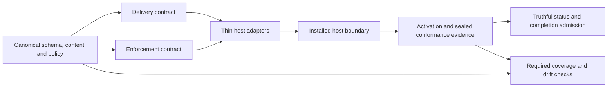

# Impl Plan: Reduce duplicated maintenance and agent drift

**Status:** planned
**Planned on:** 2026-10-20

## Approach

Canonical workflow content and shared policy feed two small contracts: **delivery**
and **enforcement**. The existing integration registry selects the host adapter.
Delivery resolves canonical resources into a directly loadable bundle or necessary
host wrapper. Enforcement normalizes the host event, calls the existing shared
decision owner, and translates its result back to the host. Install/status/doctor
and repository checks consume these same declarations; they never invent a second
supported-host list or a second policy implementation.

**Riskiest assumption:** a natively loaded Cursor/OpenCode V2 package can reach
the same canonical resources and shared decision owner without relying on legacy
project hooks or independently authored policy, and Cursor IDE can be exercised
automatically at its real Agent boundary. The cheapest load-bearing proof
combines **Native delivery exposes the contracted catalogue** with the paired
**A denied action has no side effect** / **An allowed action reaches the
side-effect boundary** examples on their exact native target. Try that small real
boundary before bulk catalogue migration. Schema/registry scaffolding is a
prerequisite, not completion of the accepted migration. A failed host proof leaves
the claim unmet and prompts an engineering repair; it does not change Product.

### Verification reuse and cadence

Author shared policy cases and conformance scenarios once. Execute each required
example through its actual host/version/runtime and delivery binding; a shared
policy pass or generic plugin-load check cannot replace boundary proof.
Routine development uses targeted shared-policy, generated-output and adapter
checks, plus real-host proof for affected guarantees before dependent work or
support claims. Broader compatibility runs use the existing verification and
release lanes. Changing cadence does not remove required examples or permit
CLI, manual, parent-agent or other-delivery results to substitute for them.
The registry derives coverage; users do not maintain a host checklist.
Model or agent-configuration changes require targeted checks when they affect
contracted workflow, reviewer authority or continuation; they do not create a
second full deterministic suite. Cloud-specific delivery remains outside scope.

### Components and interface decisions

- Extend the existing integration registry, canonical schema, and shared hook
  libraries. Keep host selection in the existing lifecycle coordinator. No
  universal execution runtime, new service, or new user-facing contract command.
- The canonical schema owns managed paths and the complete content graph:
  skills, references, guides, handbook, native workflow/worker entrypoints, and
  runtime helpers. Canonical workflow metadata owns invocation purpose; adapters
  own path, frontmatter, variable, tool-name and host-message translation.
  Shared render primitives replace OpenCode calling the Codex renderer and
  independently maintained equivalent resource rewrites.
- Add behavior bindings beside the existing shared decision owners. A binding
  names a stable behavior ID, its owner, triggering lifecycle facet, required
  guarantees, centrally permitted alternatives, and reference to canonical
  content when applicable. Host adapters refer to that binding and supply event
  decoding, host invocation and output encoding. They cannot supply another
  implementation of the workflow predicate.
- Inventory discovers the entire shipped source graph and every configured
  handler in Claude settings, Cursor settings, Codex plugin bindings and both
  OpenCode adapters. The five common lifecycle events remain a convenient
  projection, never the inventory boundary. SessionEnd, async/rewake and shell
  paths require explicit dispositions.
- Extend each adapter with version/runtime lane selection, content registration,
  event bindings and evidence projection. Native capability is distinct from
  observed activation. A disposition is either implementation, explicitly
  permitted equivalent/weaker alternative, or unmet with reason and recovery.
  Missing disposition, duplicate ID, unknown ID or competing owner fails checks.
- Normalized enforcement input carries behavior/event ID, host lane, canonical
  project/session binding, action/tool, affected paths and relevant current
  ticket/configuration observations. The existing shared policy owns parsing and
  rule decisions. Output is allow, deny, context/observe, or bounded continuation
  with reason and the precise guarantee. A host codec cannot promote observation
  to denial, ticket rejection to continuation, or continuation to ticket rejection.
- Mechanism selection filters by required guarantee set and applicable proof,
  then follows centrally declared preference order. Guarantees form capabilities,
  not a single numerical strength scale. A weaker fallback is eligible only if
  the shared binding explicitly permits it. No satisfying mechanism means unmet.
  Unknown or malformed blockable-event input follows that existing policy's
  fail-closed/fail-open rule; this feature does not globally rewrite those rules.
- Existing public lifecycle commands, result envelope and exit meanings remain
  compatible. The existing conformance interface gains an explicit manual-
  attestation mode; this additive mode never changes automated defaults.
  Add per-behavior evidence/guarantee details under result data
  and existing recovery presentation. Repository contract checks extend existing
  generated-surface/parity and CLI-contract gates. The real conformance entrypoint
  dispatches only selected hosts in customer projects; development coverage derives
  all required lanes independently of a user's selection.

### Native delivery decisions

**CLI-first testing update (user accepted 2026-10-20):** Cursor CLI
2026.09.28-64d2043 loads the same generated portable core and native extension
through its documented `--plugin-dir` option. Use this separate exact-version
runtime lane for repeatable catalogue and allowed/denied action tests. It does
not satisfy IDE example rows, activation, trust or continuation claims. Existing
IDE obligations remain required. No new policy owner or CLI-specific workflow
copy is introduced. The production extension and canonical hook declarations
remain shared between the CLI and IDE; only test driving and host observations
differ. [CLI parameters](https://cursor.com/docs/cli/reference/parameters),
[plugin hook support](https://cursor.com/docs/cli/changelog).

CLI fixtures have no competing project hooks, rules or command registrations.
Explicit `--plugin-dir` alone proves package dispatch, not IDE enrollment,
eligibility or authority-epoch handling. The current pilot runs before the new
authority gate is implemented. Its diagnostic results cannot certify that gate.

The CLI lane is an engineering test driver, not a new customer installation or
status binding. Once the shared authority gate exists, its required CLI fixture
must establish enrollment through the real lifecycle controller in the disposable
profile before the trial. Bind that record and the native SessionStart observation
to the CLI runtime/version, canonical checkout, profile, package identities and
delivery epoch; do not borrow an IDE record. SessionStart supplies the same
normalized registration/authority handshake to the shared gate that the IDE
workspace bootstrap uses. Loading through `--plugin-dir` never exempts a hook
from that gate. The controller may enroll this explicitly requested diagnostic
fixture without exposing a customer CLI enrollment path or probing unselected
customer hosts. Its records and results satisfy only their declared engineering
proof obligation; they cannot establish customer status or admission of an IDE
or other customer binding. The existing pilot results remain diagnostic-only.

Discriminating proof runs the real CLI route with native authority selected and
observes its allowed/denied effects, then omits or mismatches enrollment and
confirms the native guard stays inert. With legacy project hooks present, the
same authority gate must select exactly one decision owner, preserving legacy
protection when the native handshake is absent. Test both dispatch counts and
the resulting side effect; CLI loading cannot activate a second authority.
Rerun these cases against the final generated gate-bearing package. The existing
pre-gate CLI diagnostics cannot satisfy them or replace the separate IDE
enrollment, registration, trust, activation or continuation proofs.

Exact coverage population: seven version lanes, nine distinct host/version/runtime
rows, and ten delivery cases (Cursor 3.24.18 has native and project-hook delivery).
The eight native denial/allow outline rows are Claude 2.1.170 CLI, Codex 0.160.0
CLI, Cursor 3.24.18 IDE, Cursor 2026.09.28-64d2043 CLI, OpenCode V1 1.18.23 CLI
and TUI, and OpenCode V2 2.0.32 CLI and TUI. Add Cursor project-hook IDE 3.8.23
and 3.24.18 for ten denial/allow delivery cases. Native catalogue has six outline
rows (Claude CLI, Codex CLI, both Cursor lanes, V2 CLI and TUI), plus separately
required V1 CLI/TUI and both Cursor legacy IDE cases. Required native completion-continuation
proof targets are Claude 2.1.170 CLI, Codex 0.160.0 CLI and Cursor 3.24.18 IDE.
Retained Cursor project-hook delivery separately requires bounded completion
proof in both exact IDEs, 3.8.23 and 3.24.18, as specified under Status compatibility
and recovery. Neither delivery class can satisfy the other's evidence. No CLI
continuation claim is inferred for Cursor or OpenCode.

| Host | Chosen delivery and boundary | Limit |
| --- | --- | --- |
| Claude Code 2.1.170 | Retain native plugin; register canonical packaged skills/resources and dispatch host hooks into shared owners | Preserve minimum-version, scope, trust and current stop/reentry limits |
| Codex 0.160.0 | Retain one native compatibility container and identity/runtime; derive skills/resources from the shared renderer and keep native hook bindings in its host manifest | Exact target suppresses hooks for portable-format packages; root-format loading/precedence remains a separate resource capability proof |
| Cursor IDE 3.8.23 and 3.24.18 project hooks | Retain and independently prove the existing project-hook delivery/resources in both exact IDEs | Separate legacy delivery cases; neither supplies native evidence |
| Cursor IDE 3.24.18 | Load the shared portable content projection and necessary native hook/worker projections only where no competing project workflow registration remains; otherwise use the independently proved project-hook delivery | Static legacy references remain intact; actual IDE discovery, loaded content and guard behavior must be proved |
| OpenCode V1 1.18.23 | Retain current profile plugin, commands, workers and skills, now derived from common contracts | Keep independent V1 CLI and TUI evidence; do not adopt a V1 API requiring a later release |
| OpenCode V2 2.0.32 | Separate V2 entry using native skill and command transforms plus pre-action hook; package resources with the plugin | CLI/TUI evidence separate; no new Desktop or stop-blocking claim |
| Agent Plugins 1.0 | Generate a portable core from the same canonical assets; native enforcement remains a separate extension | Portable skill loading never establishes enforcement |

The shared content renderer is the single authoring owner for Codex and Cursor
skills/resources. Cursor receives its portable core; Codex 0.160.0 receives one
native compatibility container over that same canonical content graph. Necessary
manifest, invocation and runtime-address projections are host mechanics, not
independent skill authorship. Do not add a second Codex package just to retain a
portable root manifest: its pinned loader explicitly suppresses hooks for that
format. The isolated root-format capability pilot remains separate and ineligible
for hook guarantees. Its inline OpenAI extension overrides the compatibility
overlay for metadata, but that precedence does not establish hook discovery.
See [version-matched discovery evidence](./codex-hook-discovery.md) and the
[superseding packaging decision](../../architecture-decisions/20261020-codex-native-container.md).
Cursor's portable core owns native skill registrations and packaged resources.
The thin native extension owns hooks/workers and only necessary non-overlapping
rule facets derived from canonical metadata/content. It never registers a second
public command for a workflow the core already supplies. Native-only rule text
is generated from the same owner, with contained package references or inlined
canonical text where required by the host; it has no separately authored policy.

Legacy and Cloud project wrappers retain their existing static @references.
Static markdown does not run a resolver, and no agent is asked to fetch replacement
guidance as a prerequisite for loading it. A missing CLI resolver or native cache
cannot stop the host from loading those existing project references. Do not
rewrite tracked wrappers during local enrollment. Their necessary generated
project resources remain derived from the canonical content owner and checked
for drift; this is not an independent authoring path.

Native eligibility requires the actual catalogue to have no competing project
workflow registration. An existing checkout with retained legacy rule/command
registrations stays on the proved project-hook mechanism, even if a native cache
exists. This is automatic selection of an equally satisfying verified alternative,
not a packaging question for the user or a weakened guarantee. Contract migration
still consolidates that legacy lane's content and policy authoring. Native
registration is supported for clean eligible projects; this local cutover never
retires shared tracked wrappers to force eligibility. Project-wide retirement
remains the separately authorized migration already outside this local cutover.

For a native-eligible project, the workspace bootstrap loads the packages directly;
the host loads their contents without a rule executing shell code. If runtime or
registration fails, invalidate native claims and retain independently available
legacy guards. Do not claim restored guidance until the actual IDE has loaded
any safely reconciled legacy wrappers; a missing fallback reports unavailable
with repair/reload recovery. Never manufacture an active claim from a returned
path. Two-clone and cloud-like proofs observe actual loaded canonical content,
including with the CLI resolver unavailable and native cache absent, while
asserting unchanged tracked legacy wrapper bytes. A separate clean-project native
proof observes direct package content and rejects duplicate public registrations.
See [the superseding loading decision](../../architecture-decisions/20261020-cursor-static-guidance.md).

The hook authority gate controls hooks only; it is not claimed to suppress native
rule/command loading. The real IDE catalogue proof must enumerate rule/command
registrations as well as skills and exercise each workflow alias's resource
origin. An unexpected duplicate public workflow or second active content source
rejects native cutover; preserving legacy files is not permission for duplicates.
This choice retains necessary shared compatibility delivery where it is selected.
No undocumented Cursor suppression or dynamic markdown mechanism is assumed.
There is no second complete Cursor content bundle or user packaging choice.
Proof binds the whole delivery set, including core and extension identities.
Necessary native package-local runtime copies derive from one implementation.
Resource references resolve from the packaged skill's origin inside its own root,
not a project CWD, Codex cache path or external symlink. Preserve the existing
native authorities until exact-target core/extension loading and guard proof pass;
an unsupported root format cannot be reported as portable loading merely because
the compatibility overlay loaded. Claude and OpenCode retain their necessary
native packaging projections. All registration and helper paths stay within the
appropriate plugin root.

Portable workflow references use canonical IDs and package-relative resource
paths, not host-only invocation syntax. Native entrypoint wrappers translate
invocation syntax. Resource/helper launchers resolve from their packaged origin,
so the common core cannot depend on a Codex-only cache location or variable.

V2 uses the Promise SDK, pinned to @opencode/plugin 2.0.32 only in the V2 adapter
package. Its Tool.Error representation supplies denial feedback; Effect is the
SDK's existing 4.0.1 transitive implementation, not a new shared Safeword runtime.
Use ctx.skill.transform and ctx.command.transform with the target's schema fields.
The inspected V2 agent editor has no add operation. Do not invent one: classify
native custom-role creation unavailable and derive a guidance entrypoint for the
canonical worker procedure using the host's existing generic delegation mechanism.
This is eligible only for the current prompt-based, soft worker semantics; preserve
fresh-context and required tool/authority constraints through separate proof.
If those constraints cannot be reproduced, that worker guarantee stays unmet;
a command's presence cannot satisfy it. Existing guarded review/retro authorities
and reduced-independence rules remain authoritative. No arbitrary agent creation
or weakened outbound authority is introduced.

### Proof strategy

Primary proofs below exercise real boundaries. **Repo** means the actual
repository check process over a disposable source tree, not an injected validator.
**Admission** means the real CLI reading actual configuration and evidence stores.
**Host** means an installed package invoked by the target host: process integration
for CLI/TUI, E2E for the Cursor IDE. **Lifecycle** means the real lifecycle CLI
and filesystem/profile reconciliation; add Host proof where resource usability or
registration activation is claimed. Unit tests support pure ranking, decoding and
schema matrices but cannot discharge a Host obligation.

Repo, Admission and Lifecycle primary proofs are Integration. Host primary proof
is Integration for process protocols and E2E for the Cursor IDE; a combined row
requires both boundaries where named. No row relies on a unit-only primary proof.

Skill applicability: all scenario rows use Safeword testing guidance. Content and
resource rows additionally use the skill-authoring guide; event/guard rows use
the hooks-authoring guide; managed-template additions use schema registration.
The advertised skill inventory has no dedicated TypeScript language skill.
The touched implementation is TypeScript/JavaScript; no Go/Python feature work
or LLM-output-quality evaluation is proposed. Subjective recovery clarity stays
an independent-review limitation rather than an invented numeric eval target.

An independently maintained intended-facet fixture supplies semantic behavior IDs
for coverage checks; it contains no workflow prose or policy implementation.
Compare exact sets with discovery from shipped sources and configured handlers,
then with contract dispositions and generated outputs. A sibling generated
catalogue is never the completeness oracle. Mutation controls remove a disposition,
add an unclassified source/handler, route around a denial, add a second owner,
stale a generated output and falsify evidence identity; each must fail for its
named reason and pass after repair. Import restrictions are structural evidence,
not proof of arbitrary semantic equivalence.

| Scenario | Primary proof and real boundary | Confidence limit / supporting proof |
| --- | --- | --- |
| One shared policy change reaches every applicable agent | Host: change the real shared verification predicate and invoke every exact-version lane through installed delivery | Proves the chosen rule and tested boundary; complete inventory is separately checked |
| One shared skill change reaches every applicable agent | Host: update canonical skill/guide and load them after normal refresh across all lanes | Loading and resource closure do not prove enforcement |
| A partially propagated revision cannot satisfy the shared change | Admission: retain one stale lane while other evidence is current | Does not discover omitted lanes alone; exact-set coverage is a prerequisite |
| An interface that leaves parallel policy ownership does not count as consolidation | Repo: retain the independent old authoring path in a mutation control | Structural owner check plus shared-policy behavioral controls; no universal equivalence claim |
| Completed consolidation identifies removed maintenance paths | Repo: compare baseline owner/source inventory with migrated graph and report retired authorities | Reports removed independent edits, not file-count savings |
| Coverage includes every supported host without an author checklist | Repo: actual coverage entrypoint with complete independently checked source and lane sets | No customer-host probing |
| A missing host disposition prevents completion | Repo: omit one known disposition and assert named rejection | Unit matrices cover all missing fields |
| A newly shipped component cannot disappear from coverage | Repo: introduce each declared component kind without a disposition | Test fixture intent IDs stay independent of production discovery |
| The inventory includes handlers beyond the five common events | Repo: omit classification of real configured extra handlers | Does not infer coverage from the five-event projection |
| An explicit limitation cannot replace proof of a required guarantee | Admission: unavailable disposition cannot satisfy required completion evidence | Does not require a host to expose an impossible boundary |
| A proved OpenCode V2 lane cannot cover an unproved V1 lane | Admission: real evidence lookup keyed by separate lanes | Host tests establish each record's underlying behavior |
| New host capability cannot introduce a second shared policy owner | Repo: new capability mutation carries adapter-local policy | Covers admission of new mechanics; distinct from existing-owner regression |
| Supporting proof for the V2 worker design (not a scenario definition) | Host E2E: actual V2 generic delegation starts a fresh context and observes each declared tool/authority restriction; paired forbidden-action controls | A command listing or worker claim is insufficient; an unavailable required restriction leaves that worker guarantee unmet |
| New host capability extends mechanics while preserving shared policy | Repo: admit a new mechanical binding to the existing shared owner | Host payload proof required before an active claim |
| A stale generated host output fails the required check | Repo: real generator/check entrypoint rejects deliberate stale output | Determinism alone is not semantic parity |
| Refreshing required outputs restores agreement | Repo: normal refresh/check entrypoint over the stale tree | Host loading separately verifies resulting delivery |
| A host route cannot evade a shared denial | Repo and Host: mutate a real dispatch route and attempt the denied sentinel action | Import graph checks support but cannot replace side-effect observation |
| A route applying the shared decision passes boundary validation | Repo and Host: allow/deny controls through the genuine route | Other routes need their own bindings and conformance |
| Independent host policy cannot become another authority | Repo: mutate an existing adapter's owner boundary | Same behavioral engine may support multiple separately asserted Rules |
| A package declaration cannot substitute for runtime proof | Admission: valid manifest without host result is refused | Package validity never proves host execution |
| Evidence from a different host version cannot satisfy the required target | Admission: mismatched target version is rejected | Exact version is an engineering target, not a global downgrade policy |
| Manual host observation cannot count as an automated check | Admission: evidence method is retained and automated claim rejected | Manual proof can support only its declared real boundary |
| Failed required target execution cannot be replaced silently | Admission: failed target result remains unmet despite another available version | No automatic target substitution |
| Applicable automated target evidence satisfies the plugin claim | Admission fed by real Host result: admit matching automated evidence | Synthetic receipt tests diagnose validation only; cannot replace the host run |
| The strongest verified satisfying mechanism is selected | Integration: real adapter selection with second-discovered mechanism ranked higher | Unit tests cover partial guarantee sets and deterministic ranking |
| A permitted weaker alternative reports its actual guarantee | Admission: selected host route and centrally permitted alternative | No invented adapter fallback |
| An adapter cannot invent a weaker fallback | Repo and Admission: unauthorized fallback stays unmet | Guidance may remain usable without an enforcement claim |
| A denied action has no side effect | Host: eight native outline examples plus both named cursor-legacy IDE cases execute real denied writes across ten delivery cases | Real sentinel and policy reason required; no mocked host |
| An allowed action reaches the side-effect boundary | Host: same eight native examples and separate cursor-legacy delivery controls execute permitted write | Detects always-deny alongside the denial sibling |
| Ticket rejection cannot masquerade as conversation continuation | Admission plus Host completion outcomes | Ticket and conversation guarantees have distinct evidence IDs |
| Conversation continuation cannot masquerade as ticket-transition enforcement | Admission: continuation evidence cannot fill ticket-denial requirement | Preserve the separately proved continuation claim |
| A supported completion guard actually continues the conversation | Host: attempt actual turn completion in Claude/Codex/Cursor | Model output text alone is insufficient; observe a subsequent host turn and configured bounds |
| Applicable activation and conformance evidence reports protection active | Admission plus Host setup: real status combines conformance with local activation; include an upgraded, unenrolled Cursor checkout using retained project hooks and its own exact 3.8.23 and 3.24.18 IDE delivery-class proofs | Native and legacy Cursor proof cannot substitute; Cloud retains existing configuration-scoped reporting without inheriting desktop enforcement |
| Unavailable activation cannot inherit a healthy claim | Admission: actual missing/disabled/untrusted/failed/unknown/unsupported observations | Controlled profile fixtures; real activation supplied by Host lane |
| Invalidated evidence cannot retain the previous protection claim | Admission: change actual host/package/trust identity after proof | No arbitrary time-to-live is introduced |
| A rejected required registration invalidates its guarantee | Host: target rejects malformed required registration; status reads resulting failure | SDK mock rejection is supporting diagnosis only |
| An optional registration failure does not conceal unrelated usable protection | Host plus Admission: fail optional registration while exercising guard | Required/optional classification remains shared policy |
| Exhausted continuation cannot be advertised as unlimited enforcement | Host: reach configured continuation cap and inspect unmet evidence | No claim beyond target host limits |
| OpenCode Desktop cannot inherit CLI or TUI enforcement proof | Admission: Desktop request against CLI/TUI-only evidence | No Desktop enforcement experiment or new guarantee |
| Routine adaptation needs no packaging or host checklist decisions | Integration: genuine workflow/refresh selects all required declarations without prompts | Mechanics proof; no claim of measured user satisfaction |
| Routine reevaluation does not repeat limitation warnings | Integration: unchanged active permitted alternative is reevaluated | Warning state scoped to actual relevant guarantee/revision |
| Technical proof remains available on demand | Admission: details expose selected mechanism and applicable evidence | Missing evidence remains a disclosed limit |
| A repair requiring user trust does not silently bypass authorization | Lifecycle: trust-dependent recovery produces supported human action | No scripted trust acceptance |
| An impossible required guarantee produces actionable recovery | Admission: unsatisfiable guarantee yields affected outcome, usable remainder and concrete recovery | Cannot prove subjective clarity; independent review assesses plain wording |
| Recoverable integration failure is repaired without asking for design choices | Lifecycle plus Host: repair selected owned delivery and reverify | Successful copy alone cannot restore active status |
| A host limitation cannot lower a requirement silently | Admission: advisory functionality leaves enforced requirement unmet | Does not upgrade advice into denial |
| A host loads bundled content without an unnecessary generated copy | Codex native compatibility container: load a changed packaged skill in a scratch project without project framework content | Distribution/runtime template closure is allowed; a required project skill copy or second project skill registration must fail this proof |
| Necessary format translation preserves canonical content | Host: invoke actual required wrapper and resolve guide/helper | Output snapshots support, not replace loading |
| Native delivery exposes the contracted catalogue | Host: all exact native rows load workflow, guide and helper marker | Registration success is not denial/continuation proof |
| Portable package loading proves only its portable components | Host: Codex separately loads the root-format pilot and native compatibility delivery; Cursor loads its core plus thin native extension | Force root-format discovery for the resource capability; require actual compatibility-container guard proof on Codex |
| Duplicate native and compatibility registration is rejected | Lifecycle plus Host: inspect and reject competing active owner | Merely duplicate files do not imply competing registration |
| OpenCode V1 retains its separately proved behavior | Host: original exact V1 CLI/TUI catalogue and denial boundaries | V2 results never satisfy V1 |
| Upgrading a mixed-host project preserves authored work | Lifecycle plus Host: exercise actual eligible native migration and legacy replacement, separate/mixed-root workspaces, shared OpenCode profile, two clones and a cache-free cloud-like profile; assert actual guidance loading as well as authored bytes | Cursor checkouts with competing tracked wrappers retain verified legacy delivery; enrollment never deletes shared wrappers to force native cutover. Cloud-like checks preserve the existing boundary, not new cloud certification |
| Unproven legacy ownership cannot authorize deletion | Lifecycle: modified/unverifiable assets survive with conflict action | Trusted operator can resolve conflict; no inferred deletion consent |
| A current asset cannot be retired by a legacy cleanup collision | Repo and Lifecycle: intersect cleanup/current inventory before mutation | Exact current ownership data required |
| Repeating completed installation creates no additional authority | Lifecycle plus Host: verified install rerun yields no mutation and one active owner | Unknown activation triggers verification, not invented idempotent success |
| Interrupted migration recovers without activating two authorities | Lifecycle plus Host: kill at journal/project registration boundaries, recover A, and exercise still-legacy B under the same profile | Revalidate both enrollments and package references; host gaps stay explicitly inactive |
| Uninstalling one host preserves another host's shared resources | Lifecycle plus Host: selected uninstall leaves sibling resources loadable | No executable probing of an unselected sibling |
| Unselected hosts are not probed or enrolled | Lifecycle: all four operation rows with selected result and untouched unselected sentinels | Reading selected configuration is distinct from executing unselected probes |

New entrypoint wiring is explicit: native Cursor package discovery and every hook
route; OpenCode V2 setup, skill/command registration and pre-action dispatch;
the selected Codex compatibility-container activation and Cursor core/extension activation; and repository contract
checks. Each goes through real host/config loading or the actual check process
to the shared collaborator. Existing lifecycle CLI wiring is retained and extended
for migrations/status; no direct adapter-only test stands in for those routes.

Affected surfaces: Claude Code, OpenAI Codex, Cursor and OpenCode use the Host
proofs above; Safeword CLI uses Admission/Lifecycle/Repo; registered Agent
Plugins 1.0 uses the two portable-loading host rows. No affected surface is skipped.
The approved feature remains the behavior authority; this table is its proof
strategy, not another scenario source or verification ledger.

### Persona consequences

| Persona | Trust, operation, approval and recovery consequence | Confidence limit |
| --- | --- | --- |
| Safeword Maintainer (SWM) | One canonical content/policy edit; required all-lane checks; explicit owner-delta report; no host checklist; host API additions are mechanical adapter work | Static boundaries do not prove arbitrary semantic equivalence; runtime controls and independent review remain required |
| Technical Builder (TBU) | Preserve selected hosts and config; expose mechanism, evidence and precise guarantees; retain supported direct controls and explicit trust/ownership decisions | Current profile installation/restart/trust and exact host proof are all required; other versions/runtimes cannot inherit it |
| Non-Technical Builder (NTB) | Adapt routinely without packaging questions; name the affected outcome and one actionable recovery only when needed; retain usable advisory features with honest labels | Clear status does not manufacture protection or grant authority; trust and destructive ownership conflicts remain real decisions |

### Current and target truth

**Implemented facts:** the registry already coordinates four agents; schema owns
managed assets; canonical skills and guides already exist; native Claude/Codex
and OpenCode V1 profile delivery and existing per-host evidence/migration machinery
are present. The current source inventory contains 24 skills and 18 guides,
Claude's six configured event families and Cursor's six families, plus nested
handlers, Codex bindings, OpenCode dispatch, references and worker entrypoints.
Checkpoint 0d1061ae6 adds the shared catalogue renderer and opt-in isolated
portable writer. Default shipped Codex generation still uses its existing
compatibility projection. Generated Cursor core/extension diagnostics and the
shared Codex/Cursor session-bound completion helper are implemented. Full
catalogue/policy consolidation and the new enrollment/authority gate are not.

**Available proof:** the 58 behavior definitions passed independent scenario review
and source/ledger checks. That is specification evidence, not implementation or
installed-host proof for this design. Existing host observations retain their
documented version and delivery limits.
The portable pilot proves Codex root metadata precedence and fixture resource
loading. The exact Cursor 3.24.18 native IDE diagnostic group passes catalogue/
helper loading, allowed/denied writes and bounded continuation; the separate
exact CLI group passes catalogue/helper loading and allowed/denied writes.
See [current diagnostics and limits](./cursor-continuation-proof.md#current-implementation-and-proof).
These pre-authority-gate results are diagnostic-only, admission_eligible=false;
they do not establish sealed admission, customer activation, eligibility/
coexistence, full lifecycle or legacy project-hook proof. No CLI continuation
claim is inferred. Both required proof groups remain incomplete. Native format comparison proves that
Codex 0.160.0 discovers five untrusted hooks in compatibility format and zero
in portable format; this is discovery evidence, not hook execution.

**Target work:** common inventory/owner enforcement, full shared-policy adoption,
admitted native Cursor and OpenCode V2 delivery, truthful per-behavior projection,
production portable delivery, and full proof obligations remain unimplemented.

**Known defects/limits:** host renderers and schema currently carry overlapping
lists/rewrites; the Codex adapter contains additional intake predicates; the
OpenCode renderer depends on Codex and Cursor renderer data. These are concrete
consolidation targets, not a measured claim that every adapter is defective.
The dogfood Codex 1.2.0 restart has current prompt/pre/post-tool proof but lacks
session-start/stop proof; no complete active-protection claim is made.

**Pending human authority:** public release/merge remains outside scope. Existing
host trust/administrator policy and proven-owned cleanup authorization must be
honored at their actual boundary. Product and repaired scenarios are accepted;
there is no pending product choice or request to reapprove unchanged scope.

## Decisions

### Implementation Inspiration

| Reference | Checked on | Source version | Target version | Evidence of fit | Principle to borrow | Mismatch / license / security boundary |
| --- | --- | --- | --- | --- | --- | --- |
| [Superpowers adapter](https://github.com/obra/superpowers/blob/bb92a77741419a4ab5f06e711a283343f1ada0c3/.opencode/plugins/superpowers.js) | 2026-10-20 | bb92a77741419a4ab5f06e711a283343f1ada0c3 | OpenCode V2 2.0.32; V1 independently pinned 1.18.23 | One skill directory, separate V1/V2 registration; correct V2 path field and per-entry rejection handling | Register bundled content with narrow host translation | MIT; architectural inspiration only, no copied implementation or enforcement proof |
| [Compound Engineering converter](https://github.com/EveryInc/compound-engineering-plugin/blob/2e41b4490a37f53db0beb6d4904618da9af2f559/src/converters/claude-to-codex.ts) | 2026-10-20 | 2e41b4490a37f53db0beb6d4904618da9af2f559 | Safeword native Codex 0.160.0 and lifecycle ownership | Native skills remain sole content owner; conversion fills genuine gaps | One active delivery owner | MIT; its newer V1 baseline is not compatibility proof for 1.18.23 |
| [OpenSpec types](https://github.com/Fission-AI/OpenSpec/blob/c794978f4f8845ce59693373c9dd882ee776588c/src/core/command-generation/types.ts) | 2026-10-20 | c794978f4f8845ce59693373c9dd882ee776588c | Safeword delivery projections on all declared lanes | Tool-neutral content separated from path/frontmatter formatting | Small content contract | MIT; conversion does not establish runtime policy equivalence |

The [Codex 0.160.0 native loader](https://github.com/openai/codex/blob/rust-v0.160.0/codex-rs/core-plugins/src/loader.rs#L952-L963)
was checked 2026-10-20 against the exact pinned target and a two-profile native
comparison. It suppresses portable-format hooks while retaining compatibility
hooks. Borrow its format distinction, not its implementation; no external code
is copied or redistributed. **Decision informed:** Native and portable packaging.

**Decision impact:** retained: two small contracts, direct bundle loading and narrow
host adapters; add independent source/owner coverage and runtime proof so shared
interfaces actually eliminate parallel maintenance.
**Decision informed:** Shared authority and host adaptation

### Recorded Decisions

| Decision | Choice | Alternatives considered | Rejected because |
| --- | --- | --- | --- |
| Shared authority and host adaptation | Extend current schema/registry and shared policy owners with separate delivery/enforcement bindings; adopt [OpenSpec's content boundary](https://github.com/Fission-AI/OpenSpec/blob/c794978f4f8845ce59693373c9dd882ee776588c/src/core/command-generation/types.ts) and [Superpowers' narrow native registration](https://github.com/obra/superpowers/blob/bb92a77741419a4ab5f06e711a283343f1ada0c3/.opencode/plugins/superpowers.js) | Universal runtime; generator-only common manifest | Universal runtime erases host semantics and adds infrastructure; generation alone preserves duplicated policy |
| Native and portable packaging | One shared content renderer; native compatibility container on Codex 0.160.0; portable Cursor core plus necessary non-overlapping native facets only on eligible checkouts; retain static legacy references otherwise | Root-format Codex enforcement; Codex hook companion; agent-executed dynamic Cursor wrappers; duplicate public registration | [Pinned Codex loader](https://github.com/openai/codex/blob/rust-v0.160.0/codex-rs/core-plugins/src/loader.rs#L952-L963) suppresses root hooks; [Cursor rules](https://cursor.com/docs/rules) are static host-loaded guidance. Native 3.24.18 also exposed both user-invocable controls, so a CLI visibility setting is not IDE proof. Necessary generated static projections preserve one authored graph without weakening loading |
| OpenCode V2 transport | Promise SDK 2.0.32 isolated to V2, native transforms, typed tool denial; preserve V1 adapter | Reuse V1 entrypoint unchanged; introduce an Effect-based common Safeword runtime | [Versioned SDK docs](https://github.com/anomalyco/opencode/blob/v2.0.32/services/www/src/docs/content/build/plugins/index.mdx) show different APIs; the common runtime would spread host-specific dependency cost |
| Evidence and guarantee selection | Keep activation in native stores; add Cursor activation and distinct sealed conformance/owner records using existing receipt integrity infrastructure; rank applicable guarantees | Treat activation as release proof; duplicate activation in a central DB; trust project JSON | Activation lacks target/method/failure history; duplicate facts drift; unsigned project assertions cannot establish host execution |
| Customer version applicability | Separate exact engineering receipts from explicit publisher-owned binding-family policies, reusing current support predicates and requiring fresh activation; keep new native Cursor/V2 lanes exact initially | Pin every customer to reference binaries; run full customer conformance after every host update; infer all future versions from semver | Pins and repeated customer suites violate routine upgrade compatibility. [AIP-180](https://google.aip.dev/180) distinguishes protocol and semantic compatibility; [SemVer](https://semver.org/) provides no stability promise for Codex 0.x. Neither is a vendor guarantee. Apply the per-binding policy and upgraded-host controls below |
| Customer status evidence | Ship an integrity-bound declaration of exact host-binding proof plus composable documented shared-policy proof; combine it with current project activation. Supported non-default option combinations share the proved binding | Enumerate every option combination through every host; require customer suites for supported options; claim protection from activation alone | Opaque shared-policy inputs need policy/interaction coverage, not repeated identical host transport runs. Customer suites add friction; activation alone cannot establish the guarantee. Existing package integrity/provenance binds release proof; custom unsupported bindings need explicit local proof |
| Ownership transition | Reuse reconciler and host transactional migration with staged replacement, single-owner cutover and proof-gated cleanup; retain shared Cursor compatibility hooks/resources with profile-local authority gating | Blind copy/delete; permanently active dual delivery; remove tracked hooks after one machine migrates | [Compound Engineering's ownership handling](https://github.com/EveryInc/compound-engineering-plugin/blob/2e41b4490a37f53db0beb6d4904618da9af2f559/src/converters/claude-to-codex.ts) exposes cleanup collision risk; dual authority is ambiguous and local enrollment cannot authorize removal for teammates/cloud |
| Independent completeness and maintenance evidence | Hand-maintained intended semantic facets cross-check source discovery, then contract/output sets; baseline and retired-owner comparison | Generated catalogue checked against sibling generated catalogue; file-count savings | Self-derived completeness can miss the same facet twice; file counts cannot measure independent authoring |

The [published Agent Plugins 1.0 specification](https://github.com/agentplugins/agent-plugins-spec/blob/main/spec/1.0.0.md)
defines the root manifest, portable discovery and package containment; its 1.1
working draft is not adopted. Current [OpenAI packaging guidance](https://developers.openai.com/plugins/build/plugins)
defines the inline extension and compatibility precedence. Both describe formats;
neither establishes acceptance by the exact Codex/Cursor target without proof.

Customer applicability research (2026-10-20) also checked current Claude
minimumVersion/plugin migration guidance, Cursor version-1 hook contracts and
[OpenCode V2 migration](https://github.com/anomalyco/opencode/blob/v2.0.32/services/www/src/docs/content/build/plugins/migrate-v1.mdx).
No blanket cross-version vendor guarantee is assumed; compatibility is a scoped
Safeword support policy with reference proof and current activation. No external
implementation is copied. **Decision informed:** Customer version applicability.

The packaging decision was revised after native discovery disproved root-format
hooks on Codex 0.160.0; see codex-hook-discovery.md. No Product Rule, host target
or required guard outcome changed.

The Codex portable-package scenario remains a capability fixture with its
declared inline OpenAI enforcement extension installed but suppressed by this
host. It demonstrates the scenario's explicit limit: portable loading proves
only portable components. Actual enforcement is proved separately through the
selected compatibility container; the shipped Codex package is not described
as root-format delivery. Cursor's native skill visibility control is documented
in the linked loading decision; CLI-only metadata cannot suppress IDE aliases.

All decision evidence was retrieved 2026-10-20. Applicable versions are the exact
target versions declared in Approach and Agent Plugins 1.0. Host reference pages for
[Cursor packaging/local import](https://cursor.com/docs/plugins),
[Claude native components](https://code.claude.com/docs/en/plugins-reference),
and [OpenCode V2](https://github.com/anomalyco/opencode/blob/v2.0.32/services/www/src/docs/content/build/plugins/index.mdx)
describe APIs, not completed Safeword proof. Codex resource/runtime conventions
are reconciled with its current native delivery and exact 0.160.0 conformance
target, not inferred from another host.

The only proposed new runtime dependency is @opencode/plugin 2.0.32 in the V2
package. Published package metadata agrees with the tagged source; its license
is MIT and its transitive Effect version is 4.0.1. On 2026-10-20 the OSV query
returned no listed advisory for this exact SDK version; this is not a full
transitive audit or security guarantee. The first-party tagged SDK contains the
actual relevant implementation, with current V2 code and versioned docs rather
than only automated bumps. It couples this adapter to upstream maintenance:
retain the V1 lane and isolate the V2 binding so it can be patched or replaced.
Do not vendor downloaded research code or add this SDK to the shared CLI runtime.
Any copied substantial source requires its upstream MIT attribution; this design
borrows concepts and implements Safeword's own contract.

**Pre-mortem:** the shared contract becomes a second catalogue while adapters keep
their old policy, or a plugin loads but its guard never dispatches. Remove the
old authoring paths, require owner-delta evidence and prove native sentinel
controls before calling the migration complete.

### Registration scope and cross-project isolation

Cursor payloads live in an immutable profile cache outside the auto-discovered
local-plugin directory. Registration is **project/workspace-scoped**, not a
profile-wide plugin install: reconcile only the selected project's owned
workspaceOpen hook in its existing Cursor hook configuration. That bootstrap
returns the cached core and native-extension paths through Cursor's documented
pluginPaths result only after the project's cutover enrollment authorizes them.
Before enrollment or path publication, the actual project catalogue must have
no competing legacy workflow wrappers. If they remain, select the independently
proved project-hook mechanism and leave their static content loading unchanged.
Native installation must not generate competing project wrappers in a clean
eligible project. A profile-local request cannot retire tracked wrappers shared
with teammates or Cloud; cache presence cannot override this eligibility check.
The [current hooks contract](https://cursor.com/docs/hooks) documents workspaceOpen
and pluginPaths. Current diagnostic results and their admission limits are
recorded under Current and target truth; the earlier missing-dispatch result in
cursor-native-guard-discovery.md is historical. Registration alone establishes
none of the enforcement guarantees.
No marketplace registration or user-wide Cursor hook is introduced. Trust/admin
denial of this local discovery path remains actionable and unprotected; do not
fall back to globally activating the payload.

Cursor's automatic imports of existing Claude plugins also enter the observed
authority inventory. A separate user-data profile does not establish their
absence. A competing import with unknown or unowned bindings makes exclusive
native authority unproved: preserve its user-owned configuration, reject native
cutover, and retain only independently proved legacy claims. Never disable or
rewrite a user's global Claude plugin merely to obtain a native test pass.

Keep the existing project hooks in the shared file and add the owned workspace
bootstrap without deleting them. These generated compatibility bridges and their
reachable resources remain available to other clones and cloud runs. They invoke
the same shared decision owner; they are not independent policy implementations.
On an enrolled local workspace, their authority gate makes legacy dispatch inert
only after that workspace's native activation handshake succeeds. Otherwise they
continue existing project-hook behavior. Retaining inactive registrations is not
two active owners. Never delete tracked compatibility resources solely because
this machine's checkout switched to native delivery; another clone's need cannot
be inferred from local reference counts. Shared compatibility retirement requires
a separate explicit project-wide migration decision and is outside this cutover.

Enrollment is a versioned **profile-local record**, outside the repository, in
the existing per-host profile state hierarchy. The selected-host lifecycle
controller alone writes it under the project-then-profile locks. Its key binds
host lane, machine/profile identity and canonical checkout realpath (not just Git
remote or repository ID); values include desired delivery set, epoch, lifecycle
journal reference and migration state. It is never committed or copied to another
checkout. The installed host hook writes activation observations separately;
it cannot enroll a project. The workspace bootstrap reads enrollment plus the
current workspace/session handshake. A new session starts with legacy authority;
switch its authority only after native packages have registered successfully.
New native guards are inert without that current handshake. The existing legacy
guards are inert only with it, so native loading failure retains legacy behavior.
An absent, unreadable, stale or foreign enrollment never disables legacy guards.
Do not infer native readiness from cache presence or a previous session's receipt.

A teammate pulling the shared hook file into a second legacy clone has no enrollment
for that realpath: the bootstrap returns no paths and legacy hooks keep working.
Cursor Cloud remains on its existing project hooks and generated resources; no
native desktop enrollment, cache or new cloud guarantee is required. Explicitly
prove the bootstrap's empty-result and legacy dispatch in an isolated cloud-like
profile with no cache/enrollment, alongside two clones of the same Git repository.
Observe actual static rule/command content loading in the IDE, including when
the CLI resolver is unavailable; checking only a returned path is insufficient.
This is regression of the unchanged project-hook boundary, not new Cloud runtime
certification or Desktop-to-Cloud evidence transfer.

A second project with legacy hooks likewise loads neither new package. Native
activation proof binds the checkout and current workspace, not merely the cache.
For a multi-root workspace, every root must be enrolled for the same delivery
set/epoch before returning paths. Mixed or incompatible roots keep legacy
authority in every root, report native activation unavailable and recommend a
separate window. Test separate windows, mixed roots, two clones, missing caches,
registration failure, crashes around handshake and concurrent sibling edits.
Only generated compatibility delivery remains in the project; native content
loads directly from the package rather than another authored framework copy.

OpenCode V2 uses a **user-profile native plugins declaration** pointing to its
immutable cached local package. Reconcile that V2 plural plugins field through
the existing JSONC merge boundary, preserving the singular V1 plugin field and
all user values. This is the documented local-source configuration mechanism;
the V2 package-add CLI accepts registry/Git packages, not local paths. Do not put
a default-export V2 module into V1's automatically scanned plugin directory.
Keep V1's managed module and resources physically unchanged. V2 setup is
location-scoped and returns without registering Safeword
content or guards unless the canonical project is explicitly enrolled in the
V2 lane. For an enrolled location, its transforms replace only proven-owned V1
catalogue entries in the effective V2 catalogue; do not delete their files or
change another location. The version-matched V2 migration contract says V1 implementations do not run
in V2. Treat this as a coexistence proof obligation: start the actual V2 host
against a populated V1 profile, assert no V1 hook marker executes, then run V1
and assert its hook still executes. A failure blocks V2 enrollment.
If ownership is uncertain, report a collision rather than removing an entry.
The package installer must preserve V1-readable profile configuration; prove this
against both actual versions before enabling V2. This includes V1 and V2 sharing
a profile and two enrolled projects with different lane choices.

OpenCode V2 enrollment uses the same profile-local ownership model in its own
host family, keyed by profile/machine, canonical checkout and major-version lane.
It is distinct from the profile-wide package declaration. Only the selected-host
lifecycle controller creates or changes it; V2 setup only reads it. Absent or
foreign enrollment leaves other locations untouched and cannot retire V1 assets.

V1-to-V2 activation is in scope only as an explicit selected-project, proved
cutover. Installing V2 never upgrades another project's lane. Each process uses
its observed major version and the matching project enrollment; unsupported or
mismatched enrollment reports the missing guarantee instead of running the other
adapter. V1 files remain while any selected V1 consumer needs them. Profile-wide
V2 removal requires the existing profile authority and reference check; removing
one project's enrollment cannot remove a package still used by another. Profile
registration locks serialize package changes; project locks serialize enrollment
changes. Core/plugin hashes, canonical project hash, host version/runtime and
enrollment epoch bind proof so one project's activation cannot certify another.

### Evidence ownership and persistence

Use three distinct kinds of evidence without duplicating their authorities:

1. Existing Claude/Codex/OpenCode activation stores continue to own live runtime
   observations. Add the missing Cursor profile activation store as a declared
   native-adapter record family, keyed by canonical project and delivery epoch.
   Only the installed Cursor hook writes it from its observed event, target IDE
   version and complete package set. Its new profile-owned activation record is explicitly unsealed runtime
   observation, atomically written by the hook and owned by the current OS user.
   Validate its checkout, host/version, event, payload and epoch fields. Same-user
   code can forge it; do not claim protection against that trusted-boundary actor
   or treat it as sealed conformance. This retains existing activation confidence,
   while immutable package proof and sealed conformance stay independently checked.
   It is not conformance or release proof.
2. Add versioned **conformance-run receipts** in the project's generated Safeword
   state, separate from activation. The installed trusted Safeword conformance
   controller is the authoritative writer. Reuse the existing review receipt's
   profile-owned integrity-key and atomic sealed-record technique; a raw file
   under the project is not authority. Records contain a run/attempt ID, committed
   source revision, contract/fixture digest, exact target and observed host/runtime,
   all package/config/trust/project identities, guarantee/boundary, method
   (automated or manual), outcome (passed, failed or unavailable), and bounded
   synthetic observation digests. The controller launches and observes automated
   runs; callers cannot submit an arbitrary JSON success as automated evidence.
   Manual mode requires an explicit operator attestation, records method/manual
   and its confidence limit, and is never silently promoted to automated.
3. Retain **owner-inventory capture records** in that same sealed evidence family,
   with a different kind: before/after revision and source-graph identities,
   independent intended-facet fixture identity, owner/path sets, retired owners
   and retained mechanical translations. The trusted capture controller reads
   those committed trees and checks the oracle, rather than accepting caller-
   supplied savings. A ticket report links record IDs and presents their diff;
   the report itself cannot certify a host result or an ownership reduction.

This deliberately adds scoped record schemas; it replaces the draft's incorrect
claim that all completion evidence already exists in activation stores. It adds
no database engine and never creates a second writer for the same fact. A sealed
record authenticates capture and identity, not model quality or protection against
the trusted operator or same-user code already able to read that profile key.
Project data without the key cannot manufacture a validated record. The tested
host/profile and project fixtures do not receive the controller key.

Admission verifies record integrity and exact current identities, requires the
expected exact-set of target lanes, and consumes the latest attempt of that run
for each required lane. Retain failed/unavailable attempts immutably; a later
matching-target success may supersede their result but cannot erase them or be
replaced by another version. Idempotent capture returns the same receipt only
for identical run/input/observation identity; conflicting duplicate IDs fail.
Serialize records under the existing lock/fence discipline and atomically publish
each complete sealed record. A crash before publication yields no evidence; a
published failure remains a failure. Identity/config/contract changes invalidate
currency, and a missing key or record fails closed without replaying a fake pass.

CI validates receipts at their originating trusted runner and reports the named
target result for the producing commit through the existing CI check boundary.
Other jobs consume that commit-bound check result, not unauthenticated copied
local receipts. Do not share integrity keys through project artifacts. A manual
target gate remains explicitly manual and requires its operator/runner authority;
if unavailable, the required target remains incomplete. Local records from a
different profile are diagnostic exports only; they cannot mint current runtime
activation or satisfy another controller's local-run admission. The separately
decided package conformance projection below carries release-scoped proof across
installations without importing a foreign profile's sealed receipt.

### Customer status and distributed package proof

Choose package-bound release conformance plus local activation. The trusted
release conformance controller is the sole producer of a versioned, immutable
conformance declaration bundled with the tested native delivery set. It derives
each entry from validated originating-run receipts: exact host/version/runtime,
contract and fixture identities, executable/resource/registration payload digests,
guarantee, tested configuration-class digest, method, outcome and originating
commit/check identity. A declaration contains no profile key or customer data.
Package generation cannot fill missing results from capability declarations;
release admission rejects missing, failed or manual results for required automated
claims. Cursor IDE, including its registration/bootstrap and completion boundaries,
requires automated exact-target proof for this feature's completion. Manual runs
remain useful diagnostics but cannot clear those checks or unblock release.
Feasibility of that automation is part of the first native-boundary proof.

Extend the existing native package inventory/identity validation to cover this
declaration. It enumerates tested payload digests excluding only the declaration
and its enclosing identity carrier, avoiding a circular self-hash. The finalized
identity covers the declaration too. Distribute the complete immutable artifact
through the existing trusted package/marketplace channel and commit-bound release
checks (npm provenance where applicable). Status reads it only from the resolved,
integrity-validated installed package, never from project JSON, a user-supplied
URL, another profile's receipt or an arbitrary claimed check name. This inherits
the package installation trust boundary; self-hashes alone do not authenticate
an untrusted distribution or defend against code already trusted as that package.
No new signing service or cross-machine HMAC-key distribution is introduced.
Development builds require originating-controller validation of their local run
and payload identity before packaging a development declaration; missing proof
keeps the new contracted claim unproved.

Status requires current trusted local activation plus applicable conformance.
Ordinary installations use the package declaration. An explicitly requested,
locally sealed conformance run may prove a custom configuration class for that
same installed payload and exact target; it cannot bypass required release checks
or export proof to another machine. A local-run receipt must match its observed
exact host/runtime. A package declaration must match the observed runtime and
its explicit binding-compatibility policy below. Both must match the complete
delivery-set payload identity. Neither rewrites its originating tested version.
Choose **compositional configuration proof**, not exact enumeration of option
combinations. A host-binding class covers normalized managed event bindings,
component availability, adapter protocol, continuation boundary and payload code.
Shared-policy proof separately covers every documented configuration field, its
allowed-value partitions and declared constraint interactions, including terminalHandoffCorrection, architectureReviewGate,
crossModelReview and designApprovalGate. These values remain opaque inputs to the
same shared policy owner and cannot alter adapter routing. The schema identifies
which options enable each guarantee and its configured limit; status reports only
that actual enabled guarantee, preserving existing option semantics. Supported
non-default combinations compose with the same host-binding class and retain the
same healthy/active outcome without a customer conformance run.

The release declaration binds both host-binding and shared-policy proof digests.
Policy proof includes each option's allowed values and boundary, disabled/enabled
outcomes and every interaction declared by schema constraints or read together by a shared
policy branch. Source-owner inventory checks require each multi-option branch to
name its proof; supported combinations outside such interactions compose as
independent inputs, rather than claiming exhaustive enumeration. A real host wiring control
changes policy inputs without changing adapter code and observes the resulting
allow/deny/context/continuation outcomes. Negative controls introduce an
adapter-local option predicate, discard an option before the shared owner, and
alter a guarantee-affecting native registration; composition must reject each.
This proves the shared decision/transport separation and tested policy cases,
not arbitrary semantic correctness. Existing policy suites remain authoritative
for workflow meaning. The required check rejects any new documented option
without its policy-proof coverage and routing classification, so adding an
option cannot silently escape the composition contract.

The class identity includes schema/proof and binding identities rather than a
digest of every possible policy value. The local activation identity still binds
the actual current configuration, including those values. Cosmetic fields and
unrelated user hooks do not change the class unless they replace/interfere with a
required Safeword binding; such interference invalidates that guarantee. Unknown
managed binding changes, unsupported schema values or independent adapter policy
cannot compose and remain unproved. Native continuation limits that change host
mechanics need matching host proof; shared-policy limits use their tested schema
domain and report the actual bound. Exact-target completion evidence is never
generalized to another target; customer applicability is a separate declared
compatibility decision, as specified below.
Actual project/profile, trust, registration, enrollment epoch and current event
observations remain local activation requirements. A package declaration never
manufactures those observations. Details distinguish release-scoped conformance
from local activity and show the actual method and guarantee.

#### Customer version applicability

Keep exact engineering proof separate from customer support. The required target
matrix remains exact: a 3.8.23 run cannot clear the 3.24.18 check, and no family
policy fills a missing release check. Customer status instead evaluates a
publisher-owned compatibility policy for each proved binding/guarantee. This is
an explicit Safeword support assurance, not a claim that every compatible host
version ran the originating test, nor an assumed vendor stability promise.

Store the policy with the existing central integration/binding registry and seal
its identity in the package declaration. Reuse existing version predicates;
do not scatter additional version lists through status or adapters. Each policy
names its delivery kind, runtime, supported host predicate, public registration
and event protocol, required capabilities, host-specific continuation boundary,
originating exact proof and known exclusions. Changed required semantics create
a different binding class. Unknown protocols, missing capabilities and explicit
exclusions cannot match by proximity or by sharing a major version.

| Binding | Customer applicability | Limit |
| --- | --- | --- |
| Claude native | Existing minimum-version predicate (2.1.170) plus the declared native registration/hook protocol, required event capabilities and current activation | A newer version is not rejected merely because its number differs from the reference run; a changed required hook or continuation boundary invalidates that guarantee |
| Codex native | Existing compatibility-container loader, registration and trust support, plus the declared hook protocol; root-format readback stays a separate resource-only binding | Do not infer compatibility from 0.x semver or metadata precedence; a format change needs actual hook proof, and changed required mechanics fail applicability |
| Cursor project hooks | Existing project-hook support with manifest protocol version 1, required blockable events and the declared completion bound | Native plugin proof cannot fill this class; exact 3.8.23 and 3.24.18 legacy controls are required before shipping |
| OpenCode V1 | Existing stable 1.x support predicate plus the unchanged V1 plugin API/event binding and CLI/TUI-specific capabilities | Preserve V1 delivery; never admit a V2 protocol or transfer V1 CLI evidence to TUI |
| Cursor native | Initially exact 3.24.18 IDE with the proved workspaceOpen/pluginPaths, hook and continuation binding | A later native version needs an explicit reviewed compatibility-policy update or exact proof; retain a satisfying proved legacy mechanism when native is ineligible |
| Cursor CLI diagnostic driver | Exact 2026.09.28-64d2043 in an explicitly requested disposable test profile, using CLI-scoped controller enrollment and the shared authority gate | Test-only: no customer installation/status binding, customer-binding admission or IDE activation claim; `--plugin-dir` is not an authority exemption |
| OpenCode V2 | Initially exact 2.0.32 with its proved Promise SDK/native binding, separately for CLI and TUI | No V1/V2 evidence transfer; later support needs an explicit reviewed policy update or exact proof |

For existing delivery families, the release controller admits that compatibility
policy only with exact matrix proof, version-matched public protocol evidence,
and upgrade controls on currently supported installed hosts. Include Claude
2.1.289, Codex 0.163.0 and legacy Cursor 3.24.18 as additional compatibility
controls; these never replace the older exact reference targets. Public
registration/capability readback and actual activation supply local facts;
normal status does not run customer conformance or pretend readback alone proves
enforcement. A matching family is publisher-supported conformance backed by its
reference proof; status details show observed version, originating tested version,
policy identity and method `binding-compatible`. Exact version matches use
`exact-runtime-tested`. Fresh local activation remains mandatory in either case.
This does not promise compatibility with an arbitrary future semantic change.

**Renewal semantics:** a host-version change invalidates the old local claim,
including a policy-compatible upgrade. Renew the claim by deriving a new proof
chain on each read: validated immutable release proof and compatibility policy,
plus a new native activation observation binding the exact new version, current
payload/configuration/trust/registration and epoch. This composition is the
renewed proof required by TBU1.R2 and “Invalidated evidence cannot retain the
previous protection claim”. It establishes a publisher-supported unchanged
binding with fresh activation; it does not claim the reference test ran on the
new version. Status details expose both source identities and the method.

Do not persist a renewal receipt or introduce a signing key/controller on customer
machines. The existing native activation writer remains sole owner of activation;
its existing integrity boundary and store now bind the observed host version too.
The release controller remains sole owner of sealed package proof/policy. The
shared evidence evaluator owns the derived applicability result, writes neither
fact, and cannot convert a version string or registration readback into a native
activation. Before a new exact-observed activation exists, status stays not
active and names the existing restart/activation recovery. A normal startup
event supplies that fact automatically. Re-evaluation has no extra customer task
and no new persisted evidence to retain or clean up.

Discriminating admission proofs exercise the same compatible upgrade three ways:
old activation remains not active; fresh exact-observed activation plus valid
sealed policy yields a renewed derived proof chain and active result; excluded
policy or changed mechanics remain not active even with fresh activation. Change
the observed version, originating proof, policy identity and activation identity
independently and reject each mismatch. The accepted changed-version scenario
uses the first case, so its stale-proof assertion cannot cover only an excluded
version. Status cannot retain an earlier derived result after either input changes.

Install/upgrade/repair evaluate that policy automatically for the selected host.
They do not probe unselected agents or run the full suite in customer projects.
Supported existing activation and supported policy options retain their active
outcome after upgrade without a new setup task. Missing trust or restart still
uses existing activation recovery. Required family and policy-composition proof
must be present before shipping the changed package; an incomplete package
cannot become the new authority.

#### Status compatibility and recovery

New package identity includes `host_contract_version: 1`, protected by its
finalized inventory/provenance identity. A pre-contract package must match the
trusted historical package compatibility catalogue; absence of the marker alone
is never enough. Missing/altered marker on a new package fails integrity or
contract admission, rather than falling back to legacy semantics. Test stripping
the marker from a new package and an unknown markerless package.

When a new CLI reads a recognized old installed package without a declaration, retain the
existing top-level activation fields, result and exit code, including healthy
activation's exit 0. Add details marking the new contracted guarantee unproved
with a package-upgrade recovery. This advisory field does not retroactively make
an old package opt into the new required contract or manufacture conformance.
An activation failure still produces its existing unhealthy result/exit. Prove
both directions of this old-package/new-CLI compatibility through public status.

For a package declaring the new contract, a missing or inapplicable required
guarantee yields the existing action_required result/exit meaning; details retain
any healthy activation and explain the affected guarantee. Optional guarantees
can remain unproved without changing unrelated required protection. Unsupported
configuration loses only affected claims. Recovery preserves user options and
selects a proved compatible package/delivery when the shared contract permits it,
or offers an explicitly selected local conformance operation. It never silently
resets options. Local proof must match every current identity and boundary using
the sealed controller; manual results cannot fill automated requirements.
Unchanged limitation notices are deduplicated by configuration/guarantee identity.
Local failure or identity mismatch overrides a passing release declaration.

Retained Cursor project-hook delivery has its own cursor-project-hooks binding
class and delivery identity, separate from cursor-native. Its pre-ship proof uses
the actual 3.8.23 and 3.24.18 IDEs, generated project hooks and reachable framework resources:
catalogue/helper loading, allow/deny and the actual bounded completion guarantee.
These are delivery variants of the existing Cursor version/runtime rows, not
another agent or replacements for native proof. Its declaration ships in the trusted
Safeword CLI's resource identity and binds the canonical installed-template graph;
verify installed project resources against that owned identity rather than
trusting a declaration copied into editable project JSON. Local Cursor hook
observations use the same activation family with legacy delivery kind and
manifest-derived epoch; no native enrollment/cache is required for that class.
An upgraded, unenrolled desktop checkout with current legacy activation and its
matching class remains healthy (exit 0) and reports its actual legacy guarantee.
Absent/invalid required evidence remains action_required rather than inheriting
native proof. Supported policy options compose as above. Second clones retain
the same recovery behavior; first activation still needs the existing host event.

Cursor Cloud's existing project-hook configuration reporting and exit meaning
remain unchanged and explicitly configuration-scoped. Do not require desktop
cache/enrollment or mint a new verified Cloud enforcement claim. The cache-free
cloud-like regression checks this preservation; it cannot certify a Cloud runtime.
This distinction preserves an existing weaker report without promoting it to
the new per-guarantee desktop claim.

Release declarations remain immutable for the lifetime of their package and
survive local evidence cleanup. Repair selects a proved compatible package or
creates a new locally validated attempt; it cannot edit an installed declaration
to turn failure into success. Rollback restores the matching declaration/payload
set and re-establishes local activation. Foreign-profile diagnostic exports never
satisfy local-run admission: rerun on the consuming trusted controller, or consume
the originating commit-bound CI result for release admission only.

Retain run headers, all failed attempts and owner baselines until explicit
ticket-evidence cleanup after verification; preserve linked audit exports when
cleanup is requested. Keep only bounded synthetic observations/digests, no raw
customer conversations or credentials. Rollback creates a new attempt against the
restored identity and retains the failed attempt; it never rewrites a receipt or
relabels an old baseline. Historical unsigned records can be displayed but must
be recaptured before satisfying these new completion claims.

### Data applicability

Data applicability: shared metadata, derived packages, proof interpretation and
installed ownership transitions change. There is no new database engine or service;
the new scoped evidence record families above have distinct authoritative writers.

| Subject | Choice, reason and consequence |
| --- | --- |
| Purpose | Represent content ownership, behavior guarantees, host disposition and applicable proof so a single edit has accountable delivery |
| Store and model | Extend existing schema/registry and per-host activation/migration stores; add profile-local Cursor/V2 enrollment keyed by profile/machine and checkout realpath, Cursor activation, and sealed project conformance/owner records; package declarations are immutable derived release projections |
| Schema and relationships | Content/behavior IDs unique; each behavior has one owner and one explicit disposition per supported version/runtime lane; resources resolve within the canonical graph; the canonical renderer owns content, selected Codex container and Cursor core are their sole skill registrations, and Cursor native extension registers none |
| Source of truth | Templates/metadata and shared predicates own behavior; schema owns managed paths; selected lifecycle controller alone owns profile-local enrollment; native hook owns activation/session handshake; trusted conformance/capture controllers own sealed run/owner records; release conformance controller alone produces package conformance declarations and compatibility policies; native activation records bind observed host version through their existing writer/integrity boundary; the shared evaluator derives compatibility renewal on read without a renewal store/key/writer; reports are derived |
| Ownership and access | Repository maintainers edit canonical declarations; selected lifecycle operations mutate only their declared owned scope; existing trusted host/conformance writers create proof; project-supplied assertions cannot mint host evidence |
| Identity and integrity | Proof binds actual host version/runtime, all package identities/content in the delivery set, canonical project/profile scope, relevant trust/config identity, guarantee and test method; verify existing host receipt integrity; missing/unknown/duplicate or stale identity cannot inherit a claim |
| Cross-system flow | Source → package projection → host registration → activation/conformance record → read-only status/admission projection; an unsupported guarantee never becomes stronger across translation |
| Lifecycle and retention | Existing activation retention stays intact; new run/owner records retain failures until explicit post-verification evidence cleanup. Identity changes invalidate currency immediately; preserve backups through verified cutover, knowledge always, and remove only proven-owned retired copies |
| Migration and backfill | Keep old record readers; records lacking new binding fields remain unproved for the new guarantee until reverified. Never manufacture a current record by relabeling historical evidence |
| Compliance | Existing local project/profile trust boundary; use synthetic sentinel projects and avoid prompts/secrets/customer content in evidence. No new telemetry export, residence promise or application-managed encryption; preserve existing permissions and bounded records |
| Rollback | Restore only unchanged backed-up registration/configuration and compatible package authority under the same ownership checks; retain the failed/new evidence as non-applicable diagnosis and never overwrite later user edits |

Independent completeness uses exact semantic-ID sets and a separately maintained
intended-facet fixture; a generated representation cannot certify its sibling.
Generated artifacts are versioned projections, never authoring authorities.
Erasure/copy disposition covers canonical source (retained), installed selected
copies (retired only with ownership proof), sibling-host resources (retained while
referenced), backups/journal (existing recovery retention), proof (kept under
existing bounded retention), and project knowledge (preserved). No legal erasure,
relational storage, encryption-key lifecycle or time-expiry feature is introduced.
Validity is identity-based; timestamps remain diagnostic.

### Transition, concurrency and recovery

Per host/project, legal states are legacy-active, replacement-staged,
old-registration-disabled, replacement-active-unproved, replacement-verified,
cleanup-complete, and conflict/recovery-required. The lifecycle coordinator owns
transitions only for selected hosts and current authorization. Introduce a
project mutation lock using the existing profile-lock technique, then acquire
the host/profile lock in a fixed order; reobserve
registration, selection, ownership and digests under lock. A concurrent change
invalidates the prepared plan and requires fresh reconciliation. Before native
cutover, proven-owned legacy adapters must run the shared per-project authority
gate so stale host callbacks become no-ops after an epoch switch. If that safe
compatibility handshake is unavailable, leave cutover pending until the affected
workspace/session is closed and restarted; never activate a global replacement
and hope other projects have stopped. An already admitted event uses its captured
authority epoch; newly admitted events use the new one. Transition proof includes
cached callbacks, not only configuration-file inspection.

Stage replacement and preflight its payload in an isolated profile while legacy
is sole authority. Before live activation, make a recoverable backup and journal
the intended cutover. For Cursor, retain shared legacy registrations and switch
logical dispatch authority under the local session/epoch gate only after required
native registration is observed. The registration-handshake callback establishes
readiness without reapplying lifecycle policy already served by legacy; each event
captures one authority under the same lock. If the host cannot supply a stable
workspace/session/event identity or an atomic single-owner handshake, native
cutover remains unmet and legacy stays sole authority. Claude/Codex retain their
existing per-event live-proof-before-contraction semantics; this feature adds no
disable-first transition or intended protection gap to either. V2 is a separate
host-major lane that does not execute V1 code, so its activation does not disable
the V1 registration/resources. A same-file change uses atomic replacement.
Across project/profile files there is no fictitious global filesystem transaction:
the journal and single-owner gates control recovery. If protection is actually
lost after a failure, report it unprotected; never describe that as a successful
cutover. Trust/restart remains pending with its supported human action.

After a crash, inspect actual registrations and content against the journal.
A staged replacement is not proof of activation; a replaced registration is not
proof of guard dispatch. Retry idempotently, restoring old authority only when
replacement is inactive and the backed-up values still match. Unknown ownership,
concurrent user edits or two actual active owners produces recovery-required
without destructive guessing. After current live proof succeeds, retire only
unchanged proven-owned legacy assets that are not retained shared compatibility
resources; check the cleanup/current-asset intersection
before removal. Preserve the journal's source identities, completed stages,
backup identities and failed proof reason so restart/recovery can explain what
happened without preserving sensitive conversation data.

Mixed old/new versions coexist across separate hosts/projects during rollout,
with compatible readers and explicit lane identity. The same selected host's
registration has one active owner. The first exposure is isolated exact-version
profiles; native delivery becomes eligible for normal selection only after its
catalogue/helper, allow/deny and applicable completion boundaries pass. Failed or
unavailable proof pauses the affected claim; it does not substitute another version.
Removal and uninstall use remaining selected-owner references before deleting
shared generated resources. Never execute an unselected host to establish those
references. Existing public lifecycle recovery and exact-plan confirmation remain
the operator boundary; release or destructive cleanup still needs its normal
separate authority.

Supported downgrade first uses the current lifecycle controller to clear local
native enrollment/handshakes, verify legacy authority, and close/restart affected
sessions before applying an older release. The new native gate also checks the
expected compatibility-bridge/runtime identity before every dispatch; old
reconciliation that replaces that code invalidates native eligibility. Preserve
shared tracked resources and newer evidence as diagnosis. Directly running an
old reconciler concurrently with an active native session is unsupported: old
code cannot honor future locks or authority epochs, so no arbitrary mixed-writer
safety claim is made. Doctor detects identity/registration drift and directs the
supported rollback/repair rather than treating those assets as a healthy upgrade.
Prove controlled downgrade and replacement-identity invalidation separately.

### Measurement applicability

Measurement applicability: Product promises one authoritative edit for an existing
shared rule/skill and complete migrated-host coverage, not a time or percentage
saving. Observe authoring changes at the canonical source diff, the inventory of
independent owners before/after consolidation, reproducible outputs and actual
installed-host behavior after refresh. The population is the complete accepted
catalogue/handler inventory and seven version lanes, with nine runtime rows and ten delivery cases where
OpenCode CLI/TUI differ. Count identity sets, not emitted file totals. Missing
facets, duplicates, stale proof, failed hosts or absent observations make the
claim incomplete. Baselines and target diffs must be retained together; a selected
demo rule cannot stand in for full inventory adoption. No sampled success ratio,
invented improvement percentage or wall-clock threshold is introduced.

## Design alignment

Architecture applicability: shared content/enforcement APIs, evidence meaning and
migration compatibility change. The durable constraints are recorded in
[the durable host-contract decision](../../architecture-decisions/shared-host-contracts.md),
indexed by the configured [architecture record](../../../ARCHITECTURE.md#references).
This extends the existing registry/native-trust decision and preserves schema
ownership, reconciliation and profile isolation. Cursor's project-only delivery
statement is superseded only when its verified native cutover is implemented;
it remains the current state until then.

| Principle | Consequence | Proof | Conflict |
| --- | --- | --- | --- |
| Optimize for the NTB without constraining the TBU | Automatic adaptation with plain recovery and on-demand evidence | features/consistent-host-contract.feature | |
| 1. Structure enforces; instructions suggest | Mandatory contract/owner checks and real blockable-host proof, not prose assertions | features/consistent-host-contract.feature | |
| 2. Fire at boundaries, not every turn | Reuse existing lifecycle boundaries; cache only identity-bound observations; no new per-turn research or review loop | features/consistent-host-contract.feature | |
| 3. Add, never replace | Preserve user assets, selection and trust through proof-gated cutover | features/consistent-host-contract.feature | |
| 6. Correct and safe; then clear; then simple | Extend registry/schema and existing stores, remove parallel owners, avoid universal runtime | features/consistent-host-contract.feature | |

Existing architecture records honored: Registry-Driven Agent Integrations with
Native Trust Boundaries; Reconciliation Engine; Generated Native Claude Plugin
with Live Proof and Project Contraction; Restart-Bound Codex Plugin Activation;
the shared review coordinator and typed CLI execution contracts.
Reversible helper layout stays in this plan and Execution Planning, not an ADR.

The **One Safeword CLI lookup for every hook** reassessment trigger fires for
Cursor's bundled runtime. Its workspace bootstrap and every native hook pass that
installed runtime path to the existing single resolver; no host-specific lookup
fallback is added. **Executable Resource Contract for Native Plugin Bundles**
continues to apply: every bundle executing the standalone CLI, including the
Cursor extension and portable core, carries the complete canonical templates
resource tree and earns clean-project executable resource proof. Thin means no
separately authored workflow or second skill registration, not an artificially
small payload. These necessary derived resource copies do not violate the
single-authoring goal. Mark the Registry ADR explicitly superseded in part when
the proved Cursor cutover actually ships; it remains current until then.

## Known deviations

The current architecture describes Cursor's project authority. The proposed
native Cursor delivery is an intentional, compatibility-preserving extension,
recorded in the linked durable decision. Existing users keep legacy authority
until the proof-gated selected-host transition completes. No workflow rule is
weakened to fit a host. The V2 SDK dependency is local to that native adapter.

The new durable record is a deliberate limited departure from ARCHITECTURE.md's
preference for decisions inline. That file is already within 1 KiB of the review
coordinator's per-file context bound. Its existing section indexes the shared
record, which links the two superseding Codex/Cursor records; all three are
explicit bounded review context. No historical decision is moved
and no duplicate full record is maintained. The record holds shared constraints,
while this plan remains the feature design authority. Reassess a configured
decision directory if further durable records cannot fit the main file.

## Doc impact

README and the configured website docs must explain native Cursor/V2 delivery,
the supported version/runtime boundaries, preserved V1 support, install/repair/
uninstall behavior, trust/restart actions and truthful active-protection status.
Contributor documentation must explain the single canonical content/policy path,
required binding/disposition changes and contract checks. Update framework guides
only where these new contributor/installation contracts require it; preserve
unrelated workflow semantics. Update .project/surfaces.md to distinguish Codex's
resource-only portable capability fixture from shipped compatibility delivery,
and explain Cursor's automatic legacy selection where project registrations
prevent exclusive native activation. Execution Planning owns the update order.

## Assessment triggers

Revisit the affected decision if a required exact target rejects native registration
or shared resource closure, a V2 worker bridge cannot preserve its actual
constraints, an adapter needs independent policy to express a case, a host changes
its blockable/continuation boundary, evidence loses a binding needed for truthful
status, or a migration cannot maintain single authority and recover user edits.
If exact-target IDE automation is infeasible, the automated native claim stays
incomplete; manual observation cannot substitute without a reviewed compatibility
decision preserving the accepted proof boundary. A new supported host/version requires its own disposition and applicable proof;
do not silently change the accepted engineering targets. A native portable format
that later supplies proven equivalent hooks may justify removing an extension.
