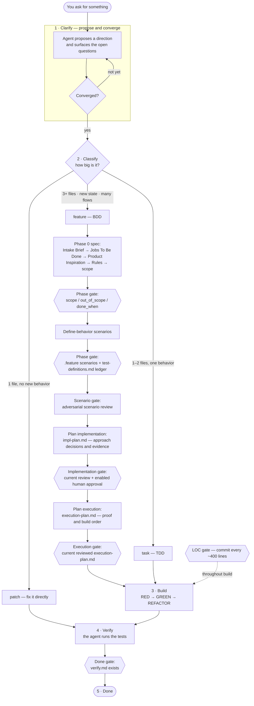

import { Aside } from '@astrojs/starlight/components';

Every safeword session runs through the same five phases, in order. Each phase has an exit you have to meet before the next one starts — and **hard gates** (listed below) stop the agent talking its way past them.



## 1 · Clarify

The agent doesn't ask twenty questions and it doesn't guess. It **proposes a direction**, then surfaces the open questions inside that proposal, and converges with you over as many turns as the ambiguity warrants — a clear request takes zero rounds, a vague idea takes two or three.

For a **feature**, this is also where the product framing gets written, in order: a short Intake Brief (who asked, the cost of not doing it, how reversible it is) → Jobs To Be Done (one persona per job) → Product Inspiration (who does this exceptionally well, what customers value, the principle to borrow, and the boundary not to copy) → Rules → engineering scope. The brief comes first and doubles as triage — if the cost of inaction is low and the change is easily reversed, it may be a leaner task, not a feature. Those scope decisions land in the ticket as `scope`, `out_of_scope`, and `done_when`.

## 2 · Classify

The agent sizes the work — it doesn't announce a label, it just picks the right track:

- **patch** — one file, no real behavior change. Fix it directly.
- **task** — one or two files, one testable behavior. Test-driven.
- **feature** — three or more files, new state, or multiple user flows. Behavior-first.
- **epic** — work too big for one feature (several user stories or a vague scope) is split into an epic whose child feature tickets link back with `parent:`.

## 3 · Build

- **patch** goes straight to the fix.
- **task** runs the TDD loop: a failing test (RED), the minimum code to pass (GREEN), then cleanup (REFACTOR).
- **feature** writes define-behavior scenarios first (saved to `features/<slug>.feature`, with `test-definitions.md` as the RED/GREEN/REFACTOR progress ledger) and validates them at the scenario gate. Implementation Planning captures current, comparable, version-matched primary evidence and settles approach decisions in `impl-plan.md`. After semantic review and any enabled human approval, Execution Planning turns those decisions into concrete proof and build order in `execution-plan.md`. Its semantic review checks that every step can start without inventing a decision. Implementation then follows the same TDD loop.

Planning review checks for both missing accepted work and additions outside
your scope. A Product Plan inventories each persona's consequential success,
refusal, failure, approval, trust and recovery outcomes, or explains why an
outcome does not apply. It distinguishes facts, assumptions and unresolved
choices. Scenario review separately checks coverage of applicable outcomes.

New external evidence reused by a plan declares its source and versions,
supported claim, license, attribution, redistribution, security, privacy and
reuse limits in a typed record. New planning verdicts retain their own typed
evidence records. Neither record grants permission, changes accepted scope or
authorizes execution of retrieved code.

A current review uses the exact canonical rules inside the trusted packaged
contract markers. An edit elsewhere can leave the review current while still
blocking use until the whole authoring copy is reconciled. With a verified
Claude author, unknown or weaker explicit Claude/Codex selectors are refused
before launch. If none was actually attempted, fallback cannot approve; select
a qualified exact model and retry. Runtime-default and OpenCode routes retain
their existing identity checks after launch.

Product approval establishes the accepted behavior, Implementation approval
the accepted approach, and Execution approval startable delivery. None proves
implementation, verification, human approval or merge authority. Codex Cloud
and OpenCode Desktop execution remains advisory; use a supported gated surface
for authoritative planning.

## 4 · Verify

The agent runs the relevant tests itself after every fix, task, or feature. It never hands you something to test that it could have tested.

## 5 · Done

A ticket can't close until `verify.md` exists in its folder — the artifact the `/verify` skill produces. No artifact, no done.

<Aside type="caution" title="The gates hard-block">
Safeword runs hooks every turn to track which phase the agent is in. These gates stop work cold rather than warn:

- **Phase gate** — can't start TDD without `test-definitions.md`; can't write that file without `scope` / `out_of_scope` / `done_when` in the ticket, and a feature also needs `spec.md` and `dimensions.md` first.
- **Phase-exit review gate** — on by default: changing a ticket's `phase:` is blocked until the phase being left has an independent review stamp (or a logged skip reason). Narrow or disable it with `reviewGate` — see [Configuration](/reference/configuration#review-gates).
- **Inspiration gates** — newly scaffolded features can't leave intake or planning without a current reference record (or a specific unsuccessful-search record). External material is treated as untrusted evidence: it cannot replace requirements, disclose private context, or authorize execution or copying.
- **Planning gates** — a feature can't enter Execution Planning without a current reviewed Implementation Plan, or enter implementation without a current reviewed Execution Plan. It can't reach verification until the Implementation Plan is reconciled against what actually shipped.
- **LOC gate** — commit roughly every 400 lines of project code, so no single change grows an unreviewable blast radius.
- **Done gate** — can't close a ticket without `verify.md`.

</Aside>

## Maintainer: bounded delivery observation

This maintenance command supports the Safeword repository's fixed T3E4NS
contract: 37 cases and 46 distinct required assertion results. Run it from a
clean committed Safeword checkout with the pinned Node/Bun toolchain, installed
lockfile dependencies and local Git, Codex, mise, tar and shell tools available.

```bash
safeword proof observe-bounded-delivery --json --no-input --offline
safeword proof verify-bounded-delivery ATTEMPT_ID --json --no-input --offline
```

For an unreleased checkout, replace `safeword` with
`scripts/dev bun packages/cli/src/cli.ts` in both commands. Run from the repository
root; no installed plugin or shared runtime replacement is required.

Replace `ATTEMPT_ID` with the first command's returned `attempt_id`. Observation
runs the fixed local lane in an isolated committed clone, retains the complete
report and binds source, runtime, profile, tools and dependencies. Verification
is read-only. Complete passing execution grants no historical RED, semantic
certification, ticket closure or host/model qualification; all 33 historical
deferrals remain unchanged. These commands never update shared review gates.

Attempts and their separate private authentication key live outside the checkout
under `$XDG_STATE_HOME/safeword/bounded-observation`, or
`~/.local/state/safeword/bounded-observation` by default. Keep that key private;
losing or replacing it invalidates old authentication. Retries allocate new IDs
and preserve earlier diagnostics. There is no automatic erasure, import or
re-signing of old evidence.

For dirty inputs, commit or clean the named files. For changed assertion source,
observe the new committed candidate. Changed accepted scope or mapping needs a
reviewed shipped-contract update. Preserve corrupt or interrupted attempts and
correct the named problem before a new observation. Bookkeeping-only Work Log,
status and named non-input audit updates need no rerun while the shipped reader
code and configuration identity matches. With changed reader code or configuration,
the observer conservatively binds those files in full. New committed assertion
bodies remain observable; this fallback does not prohibit source changes.
The match conservatively covers other tracked repository files too: even a
documentation edit can disable exemptions until the reviewed identity is refreshed.
Generated native bundles remain trusted build outputs and must pass the normal
generated-surface checks; hand-editing them is unsupported.

Runtime refusals use `BOUNDED_OBSERVATION_REFUSED`. Read `errors[].message` for
the corrective prerequisite before retrying `next_actions[].command`. Invalid
arguments use `CLI_ARGUMENT_INVALID`.

Safeword invokes no registry install, model request or qualification route during
observation. The lane uses local Codex plugin-packaging commands in disposable
profiles. `--offline` covers Safeword's declared network operations; this is
trusted local execution, with no OS network sandbox or third-party telemetry
guarantee. Source-based observations identify actual test bodies and inputs;
they do not establish that a same-named assertion still proves its intended
meaning. Later independent semantic review owns that judgment.

<footer class="docs-footer">

[GitHub](https://github.com/ArcadeAI/safeword) · MIT License · © 2026

</footer>
